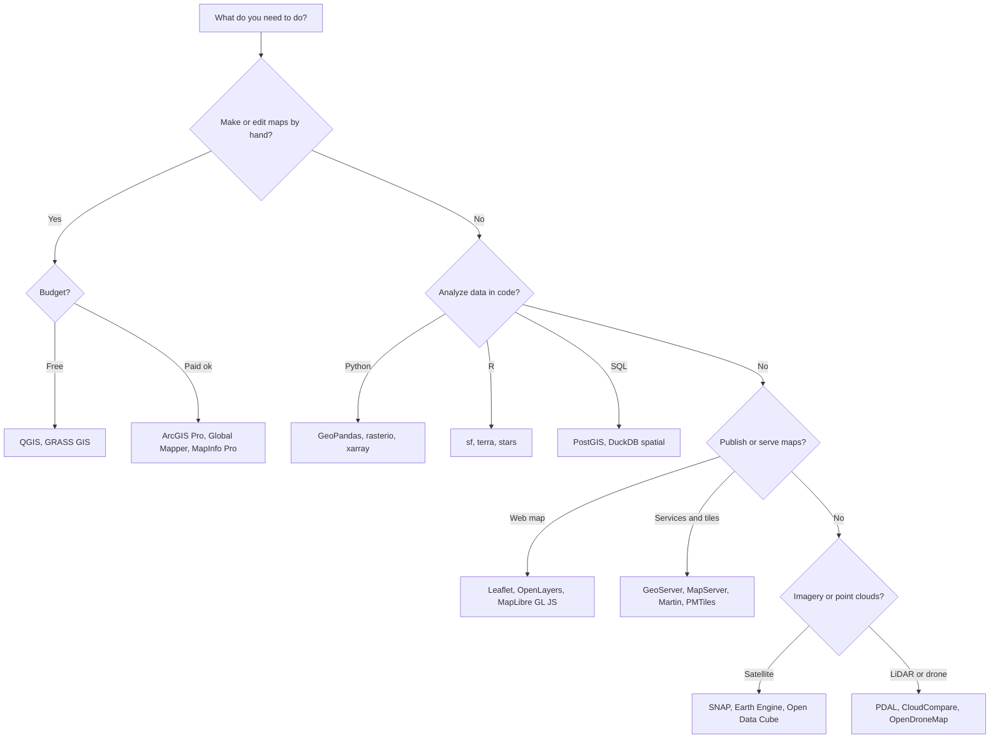

# Choosing software

| Task | Start with | Category |
| --- | --- | --- |
| Open, edit and style any spatial file | QGIS, ArcGIS Pro | [Desktop GIS](../software/desktop-gis/index.md) |
| Convert formats and reproject from a script | GDAL, ogr2ogr | [Core libraries](../software/core-libraries/index.md) |
| Vector analysis in a notebook | GeoPandas, Shapely | [Python](../software/python/index.md) |
| Raster and vector analysis in R | terra, sf | [R](../software/r/index.md) |
| Query spatial data with SQL | PostGIS, DuckDB spatial | [Databases](../software/databases/index.md) |
| Build an interactive web map | Leaflet, OpenLayers, MapLibre GL JS | [Web mapping](../software/web-mapping/index.md) |
| Publish OGC services or vector tiles | GeoServer, MapServer, Martin | [Servers and tiles](../software/servers-tiles/index.md) |
| Process Sentinel or Landsat scenes | SNAP, Open Data Cube, Earth Engine | [Remote sensing](../software/remote-sensing/index.md) |
| Classify imagery with deep learning | TorchGeo, Raster Vision | [GeoAI](../software/geoai/index.md) |
| Work with LiDAR or drone photos | PDAL, OpenDroneMap, CloudCompare | [LiDAR and 3D](../software/lidar-3d/index.md) |
| Geocode addresses or route | Nominatim, Valhalla, OSRM | [Geocoding and routing](../software/geocoding-routing/index.md) |
| Delineate watersheds from a DEM | WhiteboxTools, TauDEM | [Terrain and hydrology](../software/terrain-hydrology/index.md) |
| Test spatial autocorrelation or fit spatial models | PySAL, spdep, GeoDa | [Spatial statistics](../software/spatial-analysis/index.md) |
| Collect data in the field | QField, Mergin Maps, ODK | [Field and mobile](../software/field-mobile/index.md) |
| Plot NetCDF or GRIB data | xarray, Panoply, CDO | [Climate and ocean](../software/climate-ocean/index.md) |

## Trade-offs to check

- **License.** Open source licenses differ on redistribution. GPL tools require derived work to stay open. MIT and BSD tools do not.
- **Platform.** ArcGIS Pro runs on Windows only. QGIS and most libraries run on Windows, macOS and Linux.
- **Scale.** Single-machine tools such as GeoPandas fit data in memory. For larger data, look at DuckDB spatial, Dask-GeoPandas or Apache Sedona.
- **Hosted services.** Cloud platforms and map APIs are metered. Check the free tier and the terms before building on them.
- **Maintenance.** Each page shows a status. Legacy and retired tools are listed because older tutorials still use them.
