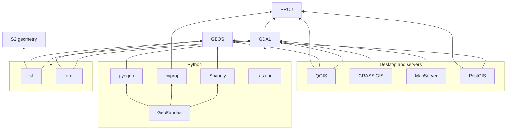

# The open source stack

Most open source geospatial tools share three C and C++ libraries. Knowing this explains why a PROJ or GDAL update changes behavior across tools.

| Layer | Library | Role |
| --- | --- | --- |
| Projections | [PROJ](../software/core-libraries/proj.md) | Coordinate reference systems and transformations |
| Geometry | [GEOS](../software/core-libraries/geos.md) | Planar geometry predicates and overlay |
| Formats | [GDAL](../software/core-libraries/gdal.md) | Reading and writing raster and vector formats |
| Spherical geometry | [S2](../software/core-libraries/s2-geometry.md) | Geometry on the sphere, used by sf |
| Java equivalents | [JTS](../software/core-libraries/jts.md), [GeoTools](../software/core-libraries/geotools.md) | Power GeoServer and many Java tools |

The diagram shows selected, documented dependencies. It is not a complete graph.
