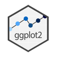

# { .title-logo } ggplot2 with geom_sf

ggplot2's geom_sf and coord_sf layers draw sf objects in R using the grammar of graphics, with automatic projection handling.

[:lucide-download: Get the software](https://ggplot2.tidyverse.org/reference/ggsf.html){ .md-button .md-button--primary }
[:lucide-book-open: Documentation](https://r-spatial.org/r/2018/10/25/ggplot2-sf.html){ .md-button }
[:lucide-code: Source code](https://github.com/tidyverse/ggplot2){ .md-button }

## At a glance

| Field | Value |
| --- | --- |
| :lucide-building-2:{ title="Who develops or maintains the software" } Developer | Posit and r-spatial |
| :lucide-monitor-smartphone:{ title="Operating systems and delivery" } Platforms | Windows, macOS, Linux |
| :lucide-code-xml:{ title="Implementation or scripting languages" } Languages | R |
| :lucide-mouse-pointer-click:{ title="How you use it" } Interface | Library |
| :lucide-scale:{ title="Terms of use. Check the provider before redistributing" } License | MIT |
| :lucide-circle-dollar-sign:{ title="What it costs to use" } Cost | Open source |
| :lucide-activity:{ title="Development state when the entry was written" } Status | Active |

## Quick start

=== "R"

    ```r
    library(ggplot2); library(sf)
    nc <- st_read(system.file("shape/nc.shp", package = "sf"))
    ggplot(nc) + geom_sf(aes(fill = AREA)) + coord_sf(crs = 5070)
    ```


## Related software

- [sf](../r/sf.md)
- [ggspatial](../r/ggspatial.md)
- [tmap](../r/tmap.md)

<script type="application/ld+json">{"@context": "https://schema.org/", "@type": "SoftwareApplication", "name": "ggplot2 with geom_sf", "description": "ggplot2's geom_sf and coord_sf layers draw sf objects in R using the grammar of graphics, with automatic projection handling.", "url": "https://noahweidig.github.io/awesome-geospatial-software/software/cartography/ggplot2-sf/", "applicationCategory": "Cartography & visualization", "operatingSystem": "Windows, macOS, Linux", "programmingLanguage": ["R"], "author": {"@type": "Organization", "name": "Posit and r-spatial"}, "keywords": ["Windows", "macOS", "Linux", "Library", "R", "Open source", "Active", "MIT", "Cartography", "Visualization", "r-spatial"], "license": "MIT", "sameAs": "https://r-spatial.org/r/2018/10/25/ggplot2-sf.html", "downloadUrl": "https://ggplot2.tidyverse.org/reference/ggsf.html", "image": "https://noahweidig.github.io/awesome-geospatial-software/assets/logos/ggplot2-sf.png", "codeRepository": "https://github.com/tidyverse/ggplot2"}</script>

[:lucide-arrow-left: Back to Cartography & visualization](index.md){ .md-button }
