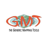

# { .title-logo } GMT (Generic Mapping Tools)

Command line toolset for processing geographic and Cartesian data and producing publication-quality maps and illustrations.

[:lucide-download: Get the software](https://www.generic-mapping-tools.org/download/){ .md-button .md-button--primary }
[:lucide-book-open: Documentation](https://docs.generic-mapping-tools.org/latest/){ .md-button }
[:lucide-code: Source code](https://github.com/GenericMappingTools/gmt){ .md-button }

## At a glance

| Field | Value |
| --- | --- |
| :lucide-building-2:{ title="Who develops or maintains the software" } Developer | GMT team |
| :lucide-monitor-smartphone:{ title="Operating systems and delivery" } Platforms | Windows, macOS, Linux |
| :lucide-code-xml:{ title="Implementation or scripting languages" } Languages | C |
| :lucide-mouse-pointer-click:{ title="How you use it" } Interface | Command line, Library |
| :lucide-scale:{ title="Terms of use. Check the provider before redistributing" } License | LGPL-3.0 |
| :lucide-circle-dollar-sign:{ title="What it costs to use" } Cost | Open source |
| :lucide-activity:{ title="Development state when the entry was written" } Status | Active |

## Related software

- [PyGMT](../python/pygmt.md)
- [Cartopy](../python/cartopy.md)

[:lucide-arrow-left: Back to Cartography & visualization](index.md){ .md-button }
