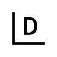
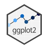
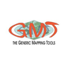
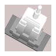

# Cartography & visualization

Map design, styling, rendering and large-scale geospatial visualization tools.

-   { .logo .middle } __[Datawrapper](datawrapper-maps.md)__

    ---

    Web tool for building choropleth, symbol and locator maps and charts from tables, with embeds and exports for publishing.

    [:lucide-arrow-right: Details](datawrapper-maps.md)

-   { .logo .middle } __[ggplot2 with geom_sf](ggplot2-sf.md)__

    ---

    ggplot2's geom_sf and coord_sf layers draw sf objects in R using the grammar of graphics, with automatic projection handling.

    [:lucide-arrow-right: Details](ggplot2-sf.md)

-   { .logo .middle } __[GMT](gmt.md)__

    ---

    Command line toolset for processing geographic and Cartesian data and producing publication-quality maps and illustrations.

    [:lucide-arrow-right: Details](gmt.md)

-   :lucide-palette:{ .lg .middle } __[Mapshaper](mapshaper.md)__

    ---

    Editor and command line tool for simplifying, clipping, dissolving and converting polygon, line and point data, with a browser interface.

    [:lucide-arrow-right: Details](mapshaper.md)

-   { .logo .middle } __[Maputnik](maputnik.md)__

    ---

    Visual editor for MapLibre and Mapbox style specifications that runs in the browser or locally.

    [:lucide-arrow-right: Details](maputnik.md)

-   :lucide-palette:{ .lg .middle } __[Observable Plot](observable-plot.md)__

    ---

    JavaScript charting library with geographic marks, projections and a graticule, for quick thematic maps in notebooks and web pages.

    [:lucide-arrow-right: Details](observable-plot.md)

-   :lucide-palette:{ .lg .middle } __[OpenOrienteering Mapper](openorienteering-mapper.md)__

    ---

    Software for drawing orienteering maps with symbol sets, templates and GPS and export tools.

    [:lucide-arrow-right: Details](openorienteering-mapper.md)

-   { .logo .middle } __[QGIS Print Layout and Atlas](qgis-layout.md)__

    ---

    QGIS map composer for building print-ready maps with scale bars, legends, grids and data-driven atlases that generate map series.

    [:lucide-arrow-right: Details](qgis-layout.md)

-   { .logo .middle } __[Tangram](tangram.md)__

    ---

    WebGL map renderer with a scene file format and shaders for custom 2D and 3D vector tile styling, with a native version for mobile.

    [:lucide-arrow-right: Details](tangram.md)

