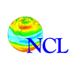

# Climate, ocean & atmosphere

Tools for gridded Earth-system data such as NetCDF and GRIB, from plotting to model post-processing.

-   :lucide-cloud-sun:{ .lg .middle } __[CDO](cdo.md)__

    ---

    Command line operators for manipulating and analyzing climate and NWP model data in NetCDF, GRIB and other formats.

    [:lucide-arrow-right: Details](cdo.md)

-   :lucide-cloud-sun:{ .lg .middle } __[cfgrib](cfgrib.md)__

    ---

    Python interface that maps GRIB files to the NetCDF data model and opens them with xarray using ecCodes.

    [:lucide-arrow-right: Details](cfgrib.md)

-   { .logo .middle } __[Copernicus Marine Toolbox](copernicus-marine-toolbox.md)__

    ---

    Python library and CLI for subsetting and downloading data from the Copernicus Marine Service.

    [:lucide-arrow-right: Details](copernicus-marine-toolbox.md)

-   :lucide-cloud-sun:{ .lg .middle } __[Herbie](herbie.md)__

    ---

    Python package that downloads numerical weather prediction model output such as HRRR, GFS and ECMWF open data from cloud archives.

    [:lucide-arrow-right: Details](herbie.md)

-   :lucide-cloud-sun:{ .lg .middle } __[MetPy](metpy.md)__

    ---

    Python toolkit for reading, visualizing and calculating with meteorological data, including skew-T plots and units support.

    [:lucide-arrow-right: Details](metpy.md)

-   { .logo .middle } __[NCL](ncl.md)__

    ---

    Interpreted language for analysis and visualization of geoscience data, now in maintenance mode with NCAR recommending Python.

    [:lucide-arrow-right: Details](ncl.md)

-   { .logo .middle } __[NCO](nco.md)__

    ---

    Command line operators that average, subset, concatenate and edit attributes of NetCDF files.

    [:lucide-arrow-right: Details](nco.md)

-   :lucide-cloud-sun:{ .lg .middle } __[ncview](ncview.md)__

    ---

    Quick-look viewer for NetCDF files with maps, animations and slicing through variables.

    [:lucide-arrow-right: Details](ncview.md)

-   { .logo .middle } __[Panoply](panoply.md)__

    ---

    NASA GISS viewer for plotting geo-gridded arrays from NetCDF, HDF and GRIB files as maps, plots and animations.

    [:lucide-arrow-right: Details](panoply.md)

-   :lucide-cloud-sun:{ .lg .middle } __[PyFerret](ferret.md)__

    ---

    NOAA PMEL analysis and visualization environment for gridded and unstructured oceanographic and atmospheric data, with a Python interface.

    [:lucide-arrow-right: Details](ferret.md)

-   :lucide-cloud-sun:{ .lg .middle } __[wrf-python](wrf-python.md)__

    ---

    Python library of diagnostics and plotting routines for WRF-ARW model output.

    [:lucide-arrow-right: Details](wrf-python.md)

