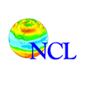

# { .title-logo } NCL (NCAR Command Language)

Interpreted language for analysis and visualization of geoscience data, now in maintenance mode with NCAR recommending Python.

[:lucide-download: Get the software](https://www.ncl.ucar.edu/){ .md-button .md-button--primary }
[:lucide-book-open: Documentation](https://www.ncl.ucar.edu/Document/){ .md-button }
[:lucide-code: Source code](https://github.com/NCAR/ncl){ .md-button }

## At a glance

| Field | Value |
| --- | --- |
| :lucide-building-2:{ title="Who develops or maintains the software" } Developer | NCAR |
| :lucide-monitor-smartphone:{ title="Operating systems and delivery" } Platforms | Linux, macOS |
| :lucide-code-xml:{ title="Implementation or scripting languages" } Languages | Vendor-specific |
| :lucide-mouse-pointer-click:{ title="How you use it" } Interface | Command line |
| :lucide-scale:{ title="Terms of use. Check the provider before redistributing" } License | Apache-2.0 |
| :lucide-circle-dollar-sign:{ title="What it costs to use" } Cost | Open source |
| :lucide-activity:{ title="Development state when the entry was written" } Status | Legacy |

!!! warning "Caveat"

    NCAR announced NCL is in maintenance mode and points users to GeoCAT and other Python tools.

## Related software

- [xarray](../python/xarray.md)
- [MetPy](../climate-ocean/metpy.md)

[:lucide-arrow-left: Back to Climate, ocean & atmosphere](index.md){ .md-button }
