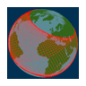
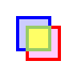
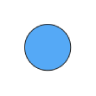
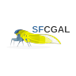
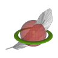

# Core libraries & engines

Low-level C, C++ and Java libraries for formats, projections and geometry that most other tools build on.

-   { .logo .middle } __[FlatGeobuf](flatgeobuf.md)__

    ---

    Binary vector format and libraries with a packed R-tree index, built for streaming and range-request reads from cloud storage.

    [:lucide-arrow-right: Details](flatgeobuf.md)

-   { .logo .middle } __[GDAL](gdal.md)__

    ---

    The translator library for raster and vector geospatial formats, with the gdal and ogr2ogr command line tools and bindings for Python, Java, C# and others.

    [:lucide-arrow-right: Details](gdal.md)

-   { .logo .middle } __[GeoArrow](geoarrow.md)__

    ---

    Specification and libraries for storing geometries in Apache Arrow arrays, enabling zero-copy exchange between tools. GeoParquet builds on the same encodings.

    [:lucide-arrow-right: Details](geoarrow.md)

-   { .logo .middle } __[GeographicLib](geographiclib.md)__

    ---

    Library for geodesic calculations on the ellipsoid, map projections and grid references such as UTM, MGRS and geoid heights.

    [:lucide-arrow-right: Details](geographiclib.md)

-   { .logo .middle } __[GEOS](geos.md)__

    ---

    C++ port of the Java Topology Suite that implements the OGC Simple Features geometry predicates and operations used by PostGIS, Shapely and sf.

    [:lucide-arrow-right: Details](geos.md)

-   { .logo .middle } __[GeoTools](geotools.md)__

    ---

    Java library for reading and writing spatial formats, rendering maps and querying data, and the engine behind GeoServer.

    [:lucide-arrow-right: Details](geotools.md)

-   :lucide-library:{ .lg .middle } __[H3](h3.md)__

    ---

    Hierarchical hexagonal grid system for indexing locations, with bindings for Python, JavaScript, Java, Go and other languages.

    [:lucide-arrow-right: Details](h3.md)

-   { .logo .middle } __[JTS Topology Suite](jts.md)__

    ---

    Java library of 2D geometry types and spatial predicates, overlay and buffer operations, which GEOS ports to C++.

    [:lucide-arrow-right: Details](jts.md)

-   :lucide-library:{ .lg .middle } __[libgeotiff](libgeotiff.md)__

    ---

    Library for reading and writing GeoTIFF georeferencing tags in TIFF files.

    [:lucide-arrow-right: Details](libgeotiff.md)

-   :lucide-library:{ .lg .middle } __[libspatialindex](libspatialindex.md)__

    ---

    C++ library implementing R-tree, MVR-tree and TPR-tree spatial indexes. It underlies the Python Rtree package.

    [:lucide-arrow-right: Details](libspatialindex.md)

-   :lucide-library:{ .lg .middle } __[MDAL](mdal.md)__

    ---

    C++ library for reading and writing mesh and unstructured grid formats such as NetCDF, GRIB and HEC-RAS outputs. QGIS uses it for mesh layers.

    [:lucide-arrow-right: Details](mdal.md)

-   :lucide-library:{ .lg .middle } __[osgEarth](osgearth.md)__

    ---

    C++ SDK for building 3D map and globe applications on OpenSceneGraph, with terrain, imagery and feature rendering.

    [:lucide-arrow-right: Details](osgearth.md)

-   { .logo .middle } __[PDAL](pdal.md)__

    ---

    Library and command line tool for translating and processing point cloud data, described as GDAL for point clouds.

    [:lucide-arrow-right: Details](pdal.md)

-   { .logo .middle } __[PROJ](proj.md)__

    ---

    Coordinate transformation and projection library with the cs2cs and projinfo tools, and the EPSG database of coordinate reference systems.

    [:lucide-arrow-right: Details](proj.md)

-   :lucide-library:{ .lg .middle } __[S2 Geometry](s2-geometry.md)__

    ---

    Library for spherical geometry that divides the globe into hierarchical cells, with a 64-bit cell ID scheme for indexing.

    [:lucide-arrow-right: Details](s2-geometry.md)

-   { .logo .middle } __[SFCGAL](sfcgal.md)__

    ---

    C++ wrapper around CGAL that adds 3D geometry operations such as extrusion, Minkowski sums and 3D intersection to PostGIS.

    [:lucide-arrow-right: Details](sfcgal.md)

-   :lucide-library:{ .lg .middle } __[Shapelib](shapelib.md)__

    ---

    C library for reading and writing ESRI Shapefiles and DBF files.

    [:lucide-arrow-right: Details](shapelib.md)

-   { .logo .middle } __[SpatiaLite](spatialite.md)__

    ---

    Spatial extension for SQLite that adds geometry types, spatial functions and spatial indexes to a single-file database.

    [:lucide-arrow-right: Details](spatialite.md)

