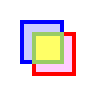

# { .title-logo } JTS Topology Suite

Java library of 2D geometry types and spatial predicates, overlay and buffer operations, which GEOS ports to C++.

[:lucide-download: Get the software](https://locationtech.github.io/jts/){ .md-button .md-button--primary }
[:lucide-book-open: Documentation](https://locationtech.github.io/jts/javadoc/){ .md-button }
[:lucide-code: Source code](https://github.com/locationtech/jts){ .md-button }

## At a glance

| Field | Value |
| --- | --- |
| :lucide-building-2:{ title="Who develops or maintains the software" } Developer | LocationTech |
| :lucide-monitor-smartphone:{ title="Operating systems and delivery" } Platforms | Windows, macOS, Linux |
| :lucide-code-xml:{ title="Implementation or scripting languages" } Languages | Java |
| :lucide-mouse-pointer-click:{ title="How you use it" } Interface | Library |
| :lucide-scale:{ title="Terms of use. Check the provider before redistributing" } License | EPL-2.0 or EDL-1.0 (BSD-3-Clause) |
| :lucide-circle-dollar-sign:{ title="What it costs to use" } Cost | Open source |
| :lucide-activity:{ title="Development state when the entry was written" } Status | Active |

## Related software

- [GEOS](../core-libraries/geos.md)
- [GeoTools](../core-libraries/geotools.md)

[:lucide-arrow-left: Back to Core libraries & engines](index.md){ .md-button }
