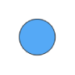

# { .title-logo } PDAL

Library and command line tool for translating and processing point cloud data, described as GDAL for point clouds.

[:lucide-download: Get the software](https://pdal.io/en/stable/download.html){ .md-button .md-button--primary }
[:lucide-book-open: Documentation](https://pdal.io/en/stable/){ .md-button }
[:lucide-code: Source code](https://github.com/PDAL/PDAL){ .md-button }

## At a glance

| Field | Value |
| --- | --- |
| :lucide-building-2:{ title="Who develops or maintains the software" } Developer | PDAL contributors |
| :lucide-monitor-smartphone:{ title="Operating systems and delivery" } Platforms | Windows, macOS, Linux |
| :lucide-code-xml:{ title="Implementation or scripting languages" } Languages | C++, Python |
| :lucide-mouse-pointer-click:{ title="How you use it" } Interface | Library, Command line |
| :lucide-scale:{ title="Terms of use. Check the provider before redistributing" } License | BSD-3-Clause |
| :lucide-circle-dollar-sign:{ title="What it costs to use" } Cost | Open source |
| :lucide-activity:{ title="Development state when the entry was written" } Status | Active |

## Related software

- [laspy](../python/laspy.md)
- [LAStools](../lidar-3d/lastools.md)
- [Entwine](../lidar-3d/entwine.md)

[:lucide-arrow-left: Back to Core libraries & engines](index.md){ .md-button }
