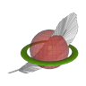

# { .title-logo } SpatiaLite

Spatial extension for SQLite that adds geometry types, spatial functions and spatial indexes to a single-file database.

[:lucide-download: Get the software](https://www.gaia-gis.it/fossil/libspatialite/index){ .md-button .md-button--primary }
[:lucide-book-open: Documentation](https://www.gaia-gis.it/gaia-sins/){ .md-button }

## At a glance

| Field | Value |
| --- | --- |
| :lucide-building-2:{ title="Who develops or maintains the software" } Developer | Alessandro Furieri |
| :lucide-monitor-smartphone:{ title="Operating systems and delivery" } Platforms | Windows, macOS, Linux |
| :lucide-code-xml:{ title="Implementation or scripting languages" } Languages | C, SQL |
| :lucide-mouse-pointer-click:{ title="How you use it" } Interface | Library, Command line |
| :lucide-scale:{ title="Terms of use. Check the provider before redistributing" } License | MPL-1.1, GPL-2.0-or-later or LGPL-2.1-or-later |
| :lucide-circle-dollar-sign:{ title="What it costs to use" } Cost | Open source |
| :lucide-activity:{ title="Development state when the entry was written" } Status | Active |

## Related software

- [PostGIS](../databases/postgis.md)
- [DuckDB spatial extension](../databases/duckdb-spatial.md)

[:lucide-arrow-left: Back to Core libraries & engines](index.md){ .md-button }
