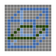

# Spatial databases & big data

Spatial SQL databases, stores and distributed engines for large vector and raster workloads.

-   { .logo .middle } __[Apache Sedona](apache-sedona.md)__

    ---

    Distributed spatial engine that adds geometry types, spatial SQL and raster operations to Apache Spark, Flink and Snowflake.

    [:lucide-arrow-right: Details](apache-sedona.md)

-   { .logo .middle } __[BigQuery GIS](bigquery-gis.md)__

    ---

    Geography type and spatial functions in Google BigQuery for large-scale analysis with SQL.

    [:lucide-arrow-right: Details](bigquery-gis.md)

-   { .logo .middle } __[DuckDB spatial extension](duckdb-spatial.md)__

    ---

    DuckDB extension that adds geometry types, spatial functions and GDAL-based file reading to an in-process analytical database.

    [:lucide-arrow-right: Details](duckdb-spatial.md)

-   :lucide-database:{ .lg .middle } __[GeoMesa](geomesa.md)__

    ---

    Suite of tools for spatio-temporal indexing and querying on distributed stores such as Accumulo, HBase, Cassandra and Kafka.

    [:lucide-arrow-right: Details](geomesa.md)

-   { .logo .middle } __[H2GIS](h2gis.md)__

    ---

    Spatial extension of the H2 Java database that implements OGC Simple Features SQL.

    [:lucide-arrow-right: Details](h2gis.md)

-   { .logo .middle } __[MobilityDB](mobilitydb.md)__

    ---

    PostgreSQL and PostGIS extension for temporal and spatiotemporal types such as moving points and trajectories.

    [:lucide-arrow-right: Details](mobilitydb.md)

-   { .logo .middle } __[Oracle Spatial](oracle-spatial.md)__

    ---

    Spatial and graph features of Oracle Database for geometry storage, indexing, geocoding, routing and raster management.

    [:lucide-arrow-right: Details](oracle-spatial.md)

-   { .logo .middle } __[pgRouting](pgrouting.md)__

    ---

    PostgreSQL and PostGIS extension with shortest path, driving distance and travelling salesperson algorithms.

    [:lucide-arrow-right: Details](pgrouting.md)

-   { .logo .middle } __[PostGIS](postgis.md)__

    ---

    Spatial extension for PostgreSQL that adds geometry, geography and raster types, spatial indexes and hundreds of SQL functions.

    [:lucide-arrow-right: Details](postgis.md)

-   { .logo .middle } __[rasdaman](rasdaman.md)__

    ---

    Array database for multi-dimensional rasters and datacubes with a query language and OGC WCS and WCPS support.

    [:lucide-arrow-right: Details](rasdaman.md)

-   { .logo .middle } __[Snowflake geospatial](snowflake-geospatial.md)__

    ---

    GEOGRAPHY and GEOMETRY data types and spatial functions in the Snowflake data cloud.

    [:lucide-arrow-right: Details](snowflake-geospatial.md)

-   { .logo .middle } __[SQL Server spatial types](sql-server-spatial.md)__

    ---

    Built-in geometry and geography data types and spatial indexes in Microsoft SQL Server and Azure SQL Database.

    [:lucide-arrow-right: Details](sql-server-spatial.md)

-   { .logo .middle } __[Tile38](tile38.md)__

    ---

    In-memory geospatial database and geofencing server with real-time notifications over webhooks and pub/sub.

    [:lucide-arrow-right: Details](tile38.md)

-   { .logo .middle } __[TileDB](tiledb.md)__

    ---

    Array storage engine for dense and sparse multi-dimensional data such as rasters, point clouds and time series, with an open source core.

    [:lucide-arrow-right: Details](tiledb.md)

-   { .logo .middle } __[WherobotsDB](wherobots.md)__

    ---

    Managed cloud platform from the creators of Apache Sedona for spatial analytics on vector and raster data.

    [:lucide-arrow-right: Details](wherobots.md)

