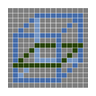

# { .title-logo } rasdaman

Array database for multi-dimensional rasters and datacubes with a query language and OGC WCS and WCPS support.

[:lucide-download: Get the software](https://rasdaman.org/){ .md-button .md-button--primary }
[:lucide-book-open: Documentation](https://doc.rasdaman.org/){ .md-button }
[:lucide-code: Source code](https://github.com/rasdaman/rasdaman){ .md-button }

## At a glance

| Field | Value |
| --- | --- |
| :lucide-building-2:{ title="Who develops or maintains the software" } Developer | rasdaman |
| :lucide-monitor-smartphone:{ title="Operating systems and delivery" } Platforms | Linux, Server |
| :lucide-code-xml:{ title="Implementation or scripting languages" } Languages | C++, SQL |
| :lucide-mouse-pointer-click:{ title="How you use it" } Interface | Service |
| :lucide-scale:{ title="Terms of use. Check the provider before redistributing" } License | GPL and LGPL (community edition) |
| :lucide-circle-dollar-sign:{ title="What it costs to use" } Cost | Open source |
| :lucide-activity:{ title="Development state when the entry was written" } Status | Active |

## Related software

- [Open Data Cube](../remote-sensing/open-data-cube.md)
- [TileDB](../databases/tiledb.md)

[:lucide-arrow-left: Back to Spatial databases & big data](index.md){ .md-button }
