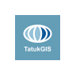

# Desktop GIS & map viewers

Full desktop applications for editing, analyzing and mapping spatial data, from ArcGIS Pro to QGIS.

-   { .logo .middle } __[ArcGIS Earth](arcgis-earth.md)__

    ---

    Free 3D globe from Esri for viewing and sharing maps, KML, shapefiles and ArcGIS services.

    [:lucide-arrow-right: Details](arcgis-earth.md)

-   { .logo .middle } __[ArcGIS Pro](arcgis-pro.md)__

    ---

    Esri's flagship 64-bit desktop GIS for mapping, editing, geoprocessing, 3D, imagery and spatial analysis, with Python scripting through ArcPy.

    [:lucide-arrow-right: Details](arcgis-pro.md)

-   { .logo .middle } __[ArcMap](arcmap.md)__

    ---

    Esri's previous desktop GIS, replaced by ArcGIS Pro. Many older tutorials, models and scripts still target it.

    [:lucide-arrow-right: Details](arcmap.md)

-   :lucide-monitor:{ .lg .middle } __[AutoCAD Map 3D toolset](autocad-map-3d.md)__

    ---

    GIS and mapping toolset included with AutoCAD for working with spatial data inside CAD drawings.

    [:lucide-arrow-right: Details](autocad-map-3d.md)

-   { .logo .middle } __[Cadcorp SIS Desktop](cadcorp-sis.md)__

    ---

    Windows desktop GIS built around OGC standards and spatial databases, from the UK vendor Cadcorp.

    [:lucide-arrow-right: Details](cadcorp-sis.md)

-   :lucide-monitor:{ .lg .middle } __[DIVA-GIS](diva-gis.md)__

    ---

    Free, lightweight desktop GIS for mapping and analyzing biodiversity and climate data, widely used in teaching.

    [:lucide-arrow-right: Details](diva-gis.md)

-   { .logo .middle } __[Global Mapper](global-mapper.md)__

    ---

    Commercial desktop GIS known for broad format support and terrain, LiDAR and 3D analysis tools, with a Pro edition for point clouds and advanced analysis.

    [:lucide-arrow-right: Details](global-mapper.md)

-   { .logo .middle } __[Google Earth Pro](google-earth-pro.md)__

    ---

    Free desktop globe for viewing imagery, importing KML and GIS files, measuring, and exporting high-resolution images and movies.

    [:lucide-arrow-right: Details](google-earth-pro.md)

-   { .logo .middle } __[GRASS GIS](grass-gis.md)__

    ---

    Open source GIS for raster, vector, imagery and time-series analysis with hundreds of modules, usable from a GUI, the command line, Python or notebooks.

    [:lucide-arrow-right: Details](grass-gis.md)

-   :lucide-monitor:{ .lg .middle } __[gvSIG Desktop](gvsig-desktop.md)__

    ---

    Open source desktop GIS written in Java, aimed at public administrations and education, with a plugin architecture.

    [:lucide-arrow-right: Details](gvsig-desktop.md)

-   :lucide-monitor:{ .lg .middle } __[Manifold](manifold.md)__

    ---

    Windows GIS and spatial SQL environment that runs queries and raster processing on multicore CPUs and GPUs. A free Viewer opens its project files.

    [:lucide-arrow-right: Details](manifold.md)

-   { .logo .middle } __[MapInfo Pro](mapinfo-pro.md)__

    ---

    Desktop GIS for location analysis and mapping, with scripting in MapBasic and Python.

    [:lucide-arrow-right: Details](mapinfo-pro.md)

-   { .logo .middle } __[Maptitude](maptitude.md)__

    ---

    Business-oriented mapping software with built-in US demographic data, territory design and redistricting tools.

    [:lucide-arrow-right: Details](maptitude.md)

-   { .logo .middle } __[Marble](marble.md)__

    ---

    KDE virtual globe and world atlas for desktop and mobile, with OpenStreetMap maps, routing and a Qt library for embedding.

    [:lucide-arrow-right: Details](marble.md)

-   { .logo .middle } __[OpenJUMP](openjump.md)__

    ---

    Java-based open source desktop GIS for viewing, editing and processing vector data, extensible with plugins and scripts.

    [:lucide-arrow-right: Details](openjump.md)

-   :lucide-package:{ .lg .middle } __[OSGeo4W](osgeo4w.md)__

    ---

    Windows installer and package repository for QGIS, GDAL, GRASS GIS and other open source geospatial tools and their dependencies.

    [:lucide-arrow-right: Details](osgeo4w.md)

-   { .logo .middle } __[OSGeoLive](osgeolive.md)__

    ---

    Bootable DVD, USB and virtual machine image preloaded with dozens of open source geospatial applications, sample data and quick starts.

    [:lucide-arrow-right: Details](osgeolive.md)

-   { .logo .middle } __[QGIS](qgis.md)__

    ---

    Free, open source desktop GIS for viewing, editing, analyzing and publishing spatial data, extensible with Python plugins and the Processing framework.

    [:lucide-arrow-right: Details](qgis.md)

-   :lucide-monitor:{ .lg .middle } __[SAGA GIS](saga-gis.md)__

    ---

    Open source GIS with a large library of terrain, hydrology, geostatistics and image analysis tools, scriptable from Python and R.

    [:lucide-arrow-right: Details](saga-gis.md)

-   { .logo .middle } __[TatukGIS](tatukgis.md)__

    ---

    Commercial desktop GIS plus developer kernels for building GIS applications on .NET, Delphi and other platforms.

    [:lucide-arrow-right: Details](tatukgis.md)

-   { .logo .middle } __[TerrSet](terrset.md)__

    ---

    Raster-oriented geospatial monitoring and modeling system that grew out of IDRISI, with Land Change Modeler and Earth Trends Modeler.

    [:lucide-arrow-right: Details](terrset.md)

