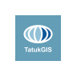

# { .title-logo } TatukGIS

Commercial desktop GIS plus developer kernels for building GIS applications on .NET, Delphi and other platforms.

[:lucide-download: Get the software](https://www.tatukgis.com/){ .md-button .md-button--primary }
[:lucide-book-open: Documentation](https://docs.tatukgis.com/){ .md-button }

## At a glance

| Field | Value |
| --- | --- |
| :lucide-building-2:{ title="Who develops or maintains the software" } Developer | TatukGIS |
| :lucide-monitor-smartphone:{ title="Operating systems and delivery" } Platforms | Windows |
| :lucide-code-xml:{ title="Implementation or scripting languages" } Languages | Delphi, C# |
| :lucide-mouse-pointer-click:{ title="How you use it" } Interface | GUI, SDK |
| :lucide-scale:{ title="Terms of use. Check the provider before redistributing" } License | Proprietary |
| :lucide-circle-dollar-sign:{ title="What it costs to use" } Cost | Paid |
| :lucide-activity:{ title="Development state when the entry was written" } Status | Active |

## Related software

- [QGIS](../desktop-gis/qgis.md)

[:lucide-arrow-left: Back to Desktop GIS & map viewers](index.md){ .md-button }
