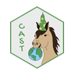
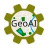

# GeoAI & machine learning

Deep learning and machine learning frameworks for imagery, point clouds and geospatial prediction.

-   { .logo .middle } __[ArcGIS Pro deep learning tools](arcgis-geoai.md)__

    ---

    Esri's tools for training and applying deep learning models to imagery, point clouds and tables inside ArcGIS Pro, with arcgis.learn in Python.

    [:lucide-arrow-right: Details](arcgis-geoai.md)

-   :lucide-brain-circuit:{ .lg .middle } __[blockCV](blockcv.md)__

    ---

    R package for spatial and environmental blocking of training and test data to avoid optimistic accuracy estimates from spatial autocorrelation.

    [:lucide-arrow-right: Details](blockcv.md)

-   { .logo .middle } __[CAST](cast-r.md)__

    ---

    R package for spatial and spatio-temporal machine learning, with forward feature selection and area of applicability estimation.

    [:lucide-arrow-right: Details](cast-r.md)

-   :lucide-brain-circuit:{ .lg .middle } __[DeepForest](deepforest.md)__

    ---

    Python package for detecting individual tree crowns in aerial RGB imagery with pretrained deep learning models.

    [:lucide-arrow-right: Details](deepforest.md)

-   { .logo .middle } __[geoai](geoai-python.md)__

    ---

    Python package for running AI workflows on geospatial data, including segmentation, object detection and model training.

    [:lucide-arrow-right: Details](geoai-python.md)

-   { .logo .middle } __[mlr3spatial](mlr3spatial.md)__

    ---

    Extension for mlr3 that predicts machine learning models on raster and vector data in R.

    [:lucide-arrow-right: Details](mlr3spatial.md)

-   { .logo .middle } __[Raster Vision](raster-vision.md)__

    ---

    Open source framework for deep learning on satellite and aerial imagery, covering chip classification, object detection and semantic segmentation.

    [:lucide-arrow-right: Details](raster-vision.md)

-   { .logo .middle } __[segment-geospatial](segment-geospatial.md)__

    ---

    Python package that applies the Segment Anything Model to georeferenced imagery and exports masks as GeoTIFF or vector data.

    [:lucide-arrow-right: Details](segment-geospatial.md)

-   { .logo .middle } __[TerraTorch](terratorch.md)__

    ---

    Fine-tuning and benchmarking toolkit for geospatial foundation models such as Prithvi, built on PyTorch Lightning and TorchGeo.

    [:lucide-arrow-right: Details](terratorch.md)

-   { .logo .middle } __[TorchGeo](torchgeo.md)__

    ---

    PyTorch domain library with datasets, samplers, transforms and pretrained models for geospatial imagery.

    [:lucide-arrow-right: Details](torchgeo.md)

