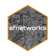

# Geocoding, routing & networks

Address search, directions, isochrones, transit planning and network analysis engines.

-   { .logo .middle } __[ArcGIS Network Analyst](esri-network-analyst.md)__

    ---

    Esri extension for ArcGIS Pro that solves routing, service area, closest facility, OD cost matrix and vehicle routing problems.

    [:lucide-arrow-right: Details](esri-network-analyst.md)

-   { .logo .middle } __[GraphHopper](graphhopper.md)__

    ---

    Java routing engine and route optimization API with open source core, based on OpenStreetMap, with a hosted Directions API.

    [:lucide-arrow-right: Details](graphhopper.md)

-   :lucide-route:{ .lg .middle } __[libpostal](libpostal.md)__

    ---

    C library that parses and normalizes street addresses using statistical models trained on OpenStreetMap and OpenAddresses.

    [:lucide-arrow-right: Details](libpostal.md)

-   { .logo .middle } __[NetworkX](networkx.md)__

    ---

    Python package for creating and analyzing graphs, widely used for road and infrastructure network analysis with OSMnx.

    [:lucide-arrow-right: Details](networkx.md)

-   :lucide-route:{ .lg .middle } __[Nominatim](nominatim.md)__

    ---

    Geocoder for OpenStreetMap data that supports search by name and address and reverse geocoding. It powers the search box on openstreetmap.org.

    [:lucide-arrow-right: Details](nominatim.md)

-   :lucide-route:{ .lg .middle } __[openrouteservice](openrouteservice.md)__

    ---

    Routing, isochrone, matrix and geocoding services from Heidelberg University, available as open source software and a hosted API.

    [:lucide-arrow-right: Details](openrouteservice.md)

-   { .logo .middle } __[OpenTripPlanner](opentripplanner.md)__

    ---

    Multimodal trip planner that combines GTFS transit, OpenStreetMap walking and cycling, and GBFS bike share data.

    [:lucide-arrow-right: Details](opentripplanner.md)

-   { .logo .middle } __[OSRM](osrm.md)__

    ---

    Fast C++ routing engine for road networks built on OpenStreetMap, with route, table, match and trip services.

    [:lucide-arrow-right: Details](osrm.md)

-   { .logo .middle } __[Pelias](pelias.md)__

    ---

    Modular open source geocoder that imports OpenStreetMap, OpenAddresses, Who's On First and other sources into Elasticsearch.

    [:lucide-arrow-right: Details](pelias.md)

-   { .logo .middle } __[Photon](photon.md)__

    ---

    Search-as-you-type geocoder for OpenStreetMap data built on OpenSearch, with typo tolerance and multilingual results.

    [:lucide-arrow-right: Details](photon.md)

-   { .logo .middle } __[R5](r5.md)__

    ---

    Java routing engine for fast multimodal transport accessibility analysis, with r5r and r5py wrappers.

    [:lucide-arrow-right: Details](r5.md)

-   { .logo .middle } __[sfnetworks](sfnetworks.md)__

    ---

    R package that combines sf and tidygraph for spatial network analysis.

    [:lucide-arrow-right: Details](sfnetworks.md)

-   { .logo .middle } __[Valhalla](valhalla.md)__

    ---

    Open source routing engine with tiled data, multimodal routing, isochrones, map matching and time-distance matrices.

    [:lucide-arrow-right: Details](valhalla.md)

