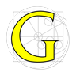

# { .title-logo } CGAL

C++ library of computational geometry algorithms including triangulations, meshes, Voronoi diagrams and polygon operations.

[:lucide-download: Get the software](https://www.cgal.org/){ .md-button .md-button--primary }
[:lucide-book-open: Documentation](https://doc.cgal.org/latest/Manual/packages.html){ .md-button }
[:lucide-code: Source code](https://github.com/CGAL/cgal){ .md-button }

## At a glance

| Field | Value |
| --- | --- |
| :lucide-building-2:{ title="Who develops or maintains the software" } Developer | CGAL Project |
| :lucide-monitor-smartphone:{ title="Operating systems and delivery" } Platforms | Windows, macOS, Linux |
| :lucide-code-xml:{ title="Implementation or scripting languages" } Languages | C++ |
| :lucide-mouse-pointer-click:{ title="How you use it" } Interface | Library |
| :lucide-scale:{ title="Terms of use. Check the provider before redistributing" } License | GPL-3.0 or commercial |
| :lucide-circle-dollar-sign:{ title="What it costs to use" } Cost | Open source |
| :lucide-activity:{ title="Development state when the entry was written" } Status | Active |

## Related software

- [SFCGAL](../core-libraries/sfcgal.md)

[:lucide-arrow-left: Back to LiDAR, photogrammetry & 3D](index.md){ .md-button }
