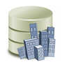

# { .title-logo } 3DCityDB

Open source database schema and tools to store, manage and export semantic 3D city models in CityGML and CityJSON on PostgreSQL.

[:lucide-download: Get the software](https://www.3dcitydb.org/){ .md-button .md-button--primary }
[:lucide-book-open: Documentation](https://3dcitydb-docs.readthedocs.io/){ .md-button }
[:lucide-code: Source code](https://github.com/3dcitydb/3dcitydb){ .md-button }

## At a glance

| Field | Value |
| --- | --- |
| :lucide-building-2:{ title="Who develops or maintains the software" } Developer | Technical University of Munich |
| :lucide-monitor-smartphone:{ title="Operating systems and delivery" } Platforms | Windows, macOS, Linux, Server |
| :lucide-code-xml:{ title="Implementation or scripting languages" } Languages | Java, SQL |
| :lucide-mouse-pointer-click:{ title="How you use it" } Interface | Command line, Service |
| :lucide-scale:{ title="Terms of use. Check the provider before redistributing" } License | Apache-2.0 |
| :lucide-circle-dollar-sign:{ title="What it costs to use" } Cost | Open source |
| :lucide-activity:{ title="Development state when the entry was written" } Status | Active |

## Related software

- [cjio](../lidar-3d/cjio.md)
- [PostGIS](../databases/postgis.md)

[:lucide-arrow-left: Back to LiDAR, photogrammetry & 3D](index.md){ .md-button }
