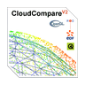

# { .title-logo } CloudCompare

Open source 3D point cloud and mesh viewer and editor with registration, comparison, segmentation and plugin support.

[:lucide-download: Get the software](https://www.cloudcompare.org/){ .md-button .md-button--primary }
[:lucide-book-open: Documentation](https://www.cloudcompare.org/doc/wiki/index.php/Main_Page){ .md-button }
[:lucide-code: Source code](https://github.com/CloudCompare/CloudCompare){ .md-button }

## At a glance

| Field | Value |
| --- | --- |
| :lucide-building-2:{ title="Who develops or maintains the software" } Developer | Daniel Girardeau-Montaut |
| :lucide-monitor-smartphone:{ title="Operating systems and delivery" } Platforms | Windows, macOS, Linux |
| :lucide-code-xml:{ title="Implementation or scripting languages" } Languages | C++ |
| :lucide-mouse-pointer-click:{ title="How you use it" } Interface | GUI, Command line, Plugin |
| :lucide-scale:{ title="Terms of use. Check the provider before redistributing" } License | GPL-2.0-or-later |
| :lucide-circle-dollar-sign:{ title="What it costs to use" } Cost | Open source |
| :lucide-activity:{ title="Development state when the entry was written" } Status | Active |

## Related software

- [PDAL](../core-libraries/pdal.md)
- [Potree](../lidar-3d/potree.md)
- [LAStools](../lidar-3d/lastools.md)

[:lucide-arrow-left: Back to LiDAR, photogrammetry & 3D](index.md){ .md-button }
