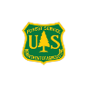

# { .title-logo } FUSION/LDV

USDA Forest Service software for viewing and analyzing LiDAR point clouds, with tools for canopy metrics and terrain models.

[:lucide-download: Get the software](https://www.fs.usda.gov/research/pnw/products/dataandtools/fusionldv){ .md-button .md-button--primary }
[:lucide-book-open: Documentation](https://www.fs.usda.gov/research/pnw/products/dataandtools/fusionldv){ .md-button }

## At a glance

| Field | Value |
| --- | --- |
| :lucide-building-2:{ title="Who develops or maintains the software" } Developer | USDA Forest Service |
| :lucide-monitor-smartphone:{ title="Operating systems and delivery" } Platforms | Windows |
| :lucide-code-xml:{ title="Implementation or scripting languages" } Languages | Vendor-specific |
| :lucide-mouse-pointer-click:{ title="How you use it" } Interface | GUI, Command line |
| :lucide-scale:{ title="Terms of use. Check the provider before redistributing" } License | Public domain |
| :lucide-circle-dollar-sign:{ title="What it costs to use" } Cost | Free to use |
| :lucide-activity:{ title="Development state when the entry was written" } Status | Maintenance mode |

## Related software

- [lidR](../r/lidr.md)
- [LAStools](../lidar-3d/lastools.md)

[:lucide-arrow-left: Back to LiDAR, photogrammetry & 3D](index.md){ .md-button }
