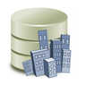
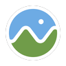
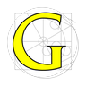
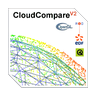
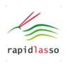
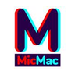
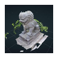

# LiDAR, photogrammetry & 3D

Point cloud processing, drone photogrammetry, city models and 3D globes.

-   { .logo .middle } __[3DCityDB](citydb-3d.md)__

    ---

    Open source database schema and tools to store, manage and export semantic 3D city models in CityGML and CityJSON on PostgreSQL.

    [:lucide-arrow-right: Details](citydb-3d.md)

-   :lucide-box:{ .lg .middle } __[Agisoft Metashape](metashape.md)__

    ---

    Commercial photogrammetry software for orthomosaics, DEMs, point clouds and textured 3D models from photos.

    [:lucide-arrow-right: Details](metashape.md)

-   { .logo .middle } __[ArcGIS CityEngine](arcgis-cityengine.md)__

    ---

    Esri's rule-based 3D modeling application for generating cities and scenes from GIS data.

    [:lucide-arrow-right: Details](arcgis-cityengine.md)

-   :lucide-box:{ .lg .middle } __[BlenderGIS](blendergis.md)__

    ---

    Blender add-on that imports shapefiles, OpenStreetMap data, DEMs and web map tiles for 3D terrain and city models.

    [:lucide-arrow-right: Details](blendergis.md)

-   { .logo .middle } __[Cesium for Unreal](cesium-unreal.md)__

    ---

    Plugin that streams 3D Tiles terrain, imagery and photogrammetry into Unreal Engine on a WGS84 globe.

    [:lucide-arrow-right: Details](cesium-unreal.md)

-   { .logo .middle } __[CGAL](cgal.md)__

    ---

    C++ library of computational geometry algorithms including triangulations, meshes, Voronoi diagrams and polygon operations.

    [:lucide-arrow-right: Details](cgal.md)

-   :lucide-box:{ .lg .middle } __[cjio](cjio.md)__

    ---

    Python command line tool and library for manipulating, validating and converting CityJSON 3D city models.

    [:lucide-arrow-right: Details](cjio.md)

-   { .logo .middle } __[CloudCompare](cloudcompare.md)__

    ---

    Open source 3D point cloud and mesh viewer and editor with registration, comparison, segmentation and plugin support.

    [:lucide-arrow-right: Details](cloudcompare.md)

-   { .logo .middle } __[Entwine](entwine.md)__

    ---

    Data organization library for massive point cloud collections that builds streamable indexes, including Entwine Point Tiles.

    [:lucide-arrow-right: Details](entwine.md)

-   { .logo .middle } __[FUSION/LDV](fusion-ldv.md)__

    ---

    USDA Forest Service software for viewing and analyzing LiDAR point clouds, with tools for canopy metrics and terrain models.

    [:lucide-arrow-right: Details](fusion-ldv.md)

-   { .logo .middle } __[LAStools](lastools.md)__

    ---

    Fast command line tools for LiDAR processing, including LAZ compression, ground classification, gridding and tiling.

    [:lucide-arrow-right: Details](lastools.md)

-   { .logo .middle } __[MicMac](micmac.md)__

    ---

    Open source photogrammetry suite from IGN for image orientation, dense matching and orthophoto production.

    [:lucide-arrow-right: Details](micmac.md)

-   { .logo .middle } __[NASA Web WorldWind](web-worldwind.md)__

    ---

    NASA's open source JavaScript virtual globe SDK for 3D maps in the browser.

    [:lucide-arrow-right: Details](web-worldwind.md)

-   { .logo .middle } __[OpenDroneMap](opendronemap.md)__

    ---

    Open source toolkit that turns drone and aerial photos into orthophotos, point clouds, DEMs and 3D models.

    [:lucide-arrow-right: Details](opendronemap.md)

-   :lucide-box:{ .lg .middle } __[PIX4Dmapper](pix4d.md)__

    ---

    Commercial photogrammetry software for drone mapping, producing orthomosaics, point clouds and elevation models.

    [:lucide-arrow-right: Details](pix4d.md)

-   { .logo .middle } __[Potree](potree.md)__

    ---

    WebGL viewer for very large point clouds in the browser, with octree conversion tools.

    [:lucide-arrow-right: Details](potree.md)

-   { .logo .middle } __[WebODM](webodm.md)__

    ---

    Web interface for OpenDroneMap that manages drone mapping projects, processing tasks and results.

    [:lucide-arrow-right: Details](webodm.md)

