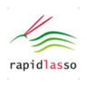

# { .title-logo } LAStools

Fast command line tools for LiDAR processing, including LAZ compression, ground classification, gridding and tiling.

[:lucide-download: Get the software](https://rapidlasso.de/){ .md-button .md-button--primary }
[:lucide-book-open: Documentation](https://rapidlasso.de/product-overview/){ .md-button }
[:lucide-code: Source code](https://github.com/LAStools/LAStools){ .md-button }

## At a glance

| Field | Value |
| --- | --- |
| :lucide-building-2:{ title="Who develops or maintains the software" } Developer | rapidlasso |
| :lucide-monitor-smartphone:{ title="Operating systems and delivery" } Platforms | Windows, Linux, macOS |
| :lucide-code-xml:{ title="Implementation or scripting languages" } Languages | C++ |
| :lucide-mouse-pointer-click:{ title="How you use it" } Interface | Command line, GUI |
| :lucide-scale:{ title="Terms of use. Check the provider before redistributing" } License | Mixed open source and proprietary (per tool) |
| :lucide-circle-dollar-sign:{ title="What it costs to use" } Cost | Freemium |
| :lucide-activity:{ title="Development state when the entry was written" } Status | Active |

!!! warning "Caveat"

    Some tools are open source. Others are free for small files and need a license for commercial or large-scale use.

## Related software

- [PDAL](../core-libraries/pdal.md)
- [CloudCompare](../lidar-3d/cloudcompare.md)

[:lucide-arrow-left: Back to LiDAR, photogrammetry & 3D](index.md){ .md-button }
