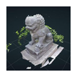

# { .title-logo } Potree

WebGL viewer for very large point clouds in the browser, with octree conversion tools.

[:lucide-download: Get the software](https://potree.github.io/){ .md-button .md-button--primary }
[:lucide-book-open: Documentation](https://github.com/potree/potree#readme){ .md-button }
[:lucide-code: Source code](https://github.com/potree/potree){ .md-button }

## At a glance

| Field | Value |
| --- | --- |
| :lucide-building-2:{ title="Who develops or maintains the software" } Developer | Markus Schütz |
| :lucide-monitor-smartphone:{ title="Operating systems and delivery" } Platforms | Web browser |
| :lucide-code-xml:{ title="Implementation or scripting languages" } Languages | JavaScript |
| :lucide-mouse-pointer-click:{ title="How you use it" } Interface | Library, Web app |
| :lucide-scale:{ title="Terms of use. Check the provider before redistributing" } License | BSD-2-Clause |
| :lucide-circle-dollar-sign:{ title="What it costs to use" } Cost | Open source |
| :lucide-activity:{ title="Development state when the entry was written" } Status | Active |

## Related software

- [Entwine](../lidar-3d/entwine.md)
- [CloudCompare](../lidar-3d/cloudcompare.md)

[:lucide-arrow-left: Back to LiDAR, photogrammetry & 3D](index.md){ .md-button }
