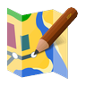

# { .title-logo } JOSM

Java OpenStreetMap editor for advanced mapping, with plugins, imagery layers, validation and offline editing.

[:lucide-download: Get the software](https://josm.openstreetmap.de/){ .md-button .md-button--primary }
[:lucide-book-open: Documentation](https://josm.openstreetmap.de/wiki/Help){ .md-button }
[:lucide-code: Source code](https://github.com/openstreetmap/josm){ .md-button }

## At a glance

| Field | Value |
| --- | --- |
| :lucide-building-2:{ title="Who develops or maintains the software" } Developer | OpenStreetMap community |
| :lucide-monitor-smartphone:{ title="Operating systems and delivery" } Platforms | Windows, macOS, Linux |
| :lucide-code-xml:{ title="Implementation or scripting languages" } Languages | Java |
| :lucide-mouse-pointer-click:{ title="How you use it" } Interface | GUI, Plugin |
| :lucide-scale:{ title="Terms of use. Check the provider before redistributing" } License | GPL-2.0-or-later |
| :lucide-circle-dollar-sign:{ title="What it costs to use" } Cost | Open source |
| :lucide-activity:{ title="Development state when the entry was written" } Status | Active |

## Related software

- [iD](../osm/id-editor.md)
- [StreetComplete](../osm/streetcomplete.md)

[:lucide-arrow-left: Back to OpenStreetMap tools](index.md){ .md-button }
