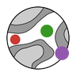
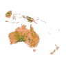
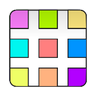

# Other languages

Geospatial libraries for Julia, Rust, Go, .NET, Java and other ecosystems.

-   { .logo .middle } __[Apache SIS](apache-sis.md)__

    ---

    Java library for spatial information systems with ISO 19115 metadata, referencing by coordinates and feature and raster I/O.

    [:lucide-arrow-right: Details](apache-sis.md)

-   :lucide-braces:{ .lg .middle } __[ArchGDAL.jl](archgdal-jl.md)__

    ---

    High-level Julia interface to GDAL for reading and writing raster and vector data.

    [:lucide-arrow-right: Details](archgdal-jl.md)

-   :lucide-braces:{ .lg .middle } __[DotSpatial](dotspatial.md)__

    ---

    .NET library for spatial data, projections and map controls for Windows Forms applications.

    [:lucide-arrow-right: Details](dotspatial.md)

-   { .logo .middle } __[gdal](georust-gdal.md)__

    ---

    Rust bindings to GDAL for reading and writing raster and vector data.

    [:lucide-arrow-right: Details](georust-gdal.md)

-   { .logo .middle } __[geo](georust-geo.md)__

    ---

    Rust crate for geospatial primitives and algorithms, the core of the GeoRust ecosystem.

    [:lucide-arrow-right: Details](georust-geo.md)

-   :lucide-braces:{ .lg .middle } __[GeoInterface.jl](geointerface-jl.md)__

    ---

    Shared interface that lets Julia geospatial packages exchange geometries without conversion.

    [:lucide-arrow-right: Details](geointerface-jl.md)

-   { .logo .middle } __[GeoMakie.jl](geomakie-jl.md)__

    ---

    Geographic plotting for Makie in Julia with projection support, rasters and vector layers.

    [:lucide-arrow-right: Details](geomakie-jl.md)

-   :lucide-braces:{ .lg .middle } __[geoPHP](geophp.md)__

    ---

    PHP library for converting between geometry formats such as WKT, WKB and GeoJSON and running geometry operations.

    [:lucide-arrow-right: Details](geophp.md)

-   { .logo .middle } __[GeoStats.jl](geostats-jl.md)__

    ---

    Geostatistical modeling in Julia with kriging, simulation, variograms and geospatial machine learning on top of Meshes.jl.

    [:lucide-arrow-right: Details](geostats-jl.md)

-   { .logo .middle } __[GeoTrellis](geotrellis.md)__

    ---

    Scala library for fast, distributed processing of raster and vector data on Spark.

    [:lucide-arrow-right: Details](geotrellis.md)

-   :lucide-braces:{ .lg .middle } __[GeoZero](geozero.md)__

    ---

    Zero-copy Rust library for reading and writing geospatial formats such as GeoJSON, WKT, FlatGeobuf and GeoPackage.

    [:lucide-arrow-right: Details](geozero.md)

-   :lucide-braces:{ .lg .middle } __[go-geom](go-geom.md)__

    ---

    Go library of geometry types with encoders and decoders for WKB, WKT, GeoJSON and other formats.

    [:lucide-arrow-right: Details](go-geom.md)

-   :lucide-braces:{ .lg .middle } __[Meshes.jl](meshes-jl.md)__

    ---

    Computational geometry and mesh types for Julia used across the JuliaEarth ecosystem.

    [:lucide-arrow-right: Details](meshes-jl.md)

-   { .logo .middle } __[NetTopologySuite](nettopologysuite.md)__

    ---

    .NET port of JTS for geometry operations, with readers and writers for common formats.

    [:lucide-arrow-right: Details](nettopologysuite.md)

-   :lucide-braces:{ .lg .middle } __[orb](orb.md)__

    ---

    Go library for 2D geometry, with clipping, simplification, quadtrees and Mapbox Vector Tile and GeoJSON support.

    [:lucide-arrow-right: Details](orb.md)

-   { .logo .middle } __[proj](georust-proj.md)__

    ---

    Rust bindings to PROJ for coordinate transformation, with the ability to build PROJ from source.

    [:lucide-arrow-right: Details](georust-proj.md)

-   { .logo .middle } __[Rasters.jl](rasters-jl.md)__

    ---

    Julia package for reading, writing and manipulating raster data and data cubes from many sources.

    [:lucide-arrow-right: Details](rasters-jl.md)

-   { .logo .middle } __[RGeo](rgeo.md)__

    ---

    Ruby library for geospatial data types, with GEOS and PROJ backends and adapters for ActiveRecord and PostGIS.

    [:lucide-arrow-right: Details](rgeo.md)

-   { .logo .middle } __[SharpMap](sharpmap.md)__

    ---

    .NET mapping engine for rendering GIS data to images in desktop and web applications.

    [:lucide-arrow-right: Details](sharpmap.md)

-   :lucide-braces:{ .lg .middle } __[Spatial4j](spatial4j.md)__

    ---

    Java library for spatial shapes and distance calculations used by Lucene, Solr and Elasticsearch.

    [:lucide-arrow-right: Details](spatial4j.md)

-   :lucide-braces:{ .lg .middle } __[turf-swift](turf-swift.md)__

    ---

    Swift geometry and geoprocessing library, a port of Turf.js for iOS and macOS.

    [:lucide-arrow-right: Details](turf-swift.md)

