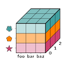

# Python libraries

Vector, raster, array, mapping and cloud-data packages for the Python geospatial stack.

-   { .logo .middle } __[ArcGIS API for Python](arcgis-api-python.md)__

    ---

    Esri's Python library for managing ArcGIS Online and Enterprise content, spatial analysis, and deep learning workflows.

    [:lucide-arrow-right: Details](arcgis-api-python.md)

-   { .logo .middle } __[ArcPy](arcpy.md)__

    ---

    Esri's Python site package for geoprocessing, map automation and data management inside ArcGIS Pro and ArcGIS Server.

    [:lucide-arrow-right: Details](arcpy.md)

-   { .logo .middle } __[Cartopy](cartopy.md)__

    ---

    Matplotlib-based mapping with projection support, transformations and Natural Earth feature layers for publication maps.

    [:lucide-arrow-right: Details](cartopy.md)

-   :lucide-file-code:{ .lg .middle } __[contextily](contextily.md)__

    ---

    Adds web tile basemaps to GeoPandas and Matplotlib plots and downloads tiles for a bounding box.

    [:lucide-arrow-right: Details](contextily.md)

-   { .logo .middle } __[dask-geopandas](dask-geopandas.md)__

    ---

    Parallel and out-of-core GeoPandas using Dask, with spatial partitioning for large vector datasets.

    [:lucide-arrow-right: Details](dask-geopandas.md)

-   { .logo .middle } __[Datashader](datashader.md)__

    ---

    Rasterizes very large point, line and grid datasets into images so billions of records can be plotted without overplotting.

    [:lucide-arrow-right: Details](datashader.md)

-   { .logo .middle } __[Earth Engine Python API](earthengine-api.md)__

    ---

    Python client library for Google Earth Engine that runs analyses server side on its data catalog.

    [:lucide-arrow-right: Details](earthengine-api.md)

-   { .logo .middle } __[earthaccess](earthaccess.md)__

    ---

    Python library to search, download and stream NASA Earthdata products with Earthdata Login authentication.

    [:lucide-arrow-right: Details](earthaccess.md)

-   { .logo .middle } __[EODAG](eodag.md)__

    ---

    Python client and CLI that searches and downloads Earth observation products from many providers through one interface.

    [:lucide-arrow-right: Details](eodag.md)

-   :lucide-file-code:{ .lg .middle } __[Fiona](fiona.md)__

    ---

    Python library for reading and writing vector formats through OGR, using GeoJSON-like dictionaries.

    [:lucide-arrow-right: Details](fiona.md)

-   { .logo .middle } __[folium](folium.md)__

    ---

    Builds Leaflet maps from Python with choropleths, markers and plugins and exports them to standalone HTML.

    [:lucide-arrow-right: Details](folium.md)

-   { .logo .middle } __[geemap](geemap.md)__

    ---

    Interactive mapping and analysis of Google Earth Engine data in Jupyter notebooks, with many other mapping backends.

    [:lucide-arrow-right: Details](geemap.md)

-   { .logo .middle } __[GeoPandas](geopandas.md)__

    ---

    Pandas extension that adds geometry columns, spatial joins, overlays and file reading and writing for vector data.

    [:lucide-arrow-right: Details](geopandas.md)

-   { .logo .middle } __[GeoPy](geopy.md)__

    ---

    Python client for many geocoding services and geodesic distance calculations.

    [:lucide-arrow-right: Details](geopy.md)

-   { .logo .middle } __[GeoViews](geoviews.md)__

    ---

    HoloViz library that adds geographic plotting to HoloViews, with Bokeh and Matplotlib backends and Cartopy projections.

    [:lucide-arrow-right: Details](geoviews.md)

-   { .logo .middle } __[h3-py](h3-py.md)__

    ---

    Official Python bindings for the H3 hexagonal grid library.

    [:lucide-arrow-right: Details](h3-py.md)

-   :lucide-file-code:{ .lg .middle } __[ipyleaflet](ipyleaflet.md)__

    ---

    Jupyter widget library that brings interactive Leaflet maps into notebooks with two-way Python and JavaScript communication.

    [:lucide-arrow-right: Details](ipyleaflet.md)

-   { .logo .middle } __[laspy](laspy.md)__

    ---

    Pure Python library for reading, modifying and writing LAS and LAZ LiDAR files.

    [:lucide-arrow-right: Details](laspy.md)

-   { .logo .middle } __[leafmap](leafmap.md)__

    ---

    Python package for interactive geospatial mapping in Jupyter with ipyleaflet, folium, MapLibre and other backends.

    [:lucide-arrow-right: Details](leafmap.md)

-   { .logo .middle } __[lonboard](lonboard.md)__

    ---

    Fast GeoPandas and GeoArrow visualization in Jupyter using deck.gl, able to render millions of features.

    [:lucide-arrow-right: Details](lonboard.md)

-   { .logo .middle } __[momepy](momepy.md)__

    ---

    Urban morphology measurement toolkit that quantifies buildings, streets and tessellations in GeoPandas.

    [:lucide-arrow-right: Details](momepy.md)

-   { .logo .middle } __[MovingPandas](movingpandas.md)__

    ---

    Trajectory data analysis on GeoPandas, with tools for cleaning, splitting, generalizing and plotting movement tracks.

    [:lucide-arrow-right: Details](movingpandas.md)

-   { .logo .middle } __[odc-stac](odc-stac.md)__

    ---

    Loads STAC items into xarray datasets with resampling and reprojection, from the Open Data Cube community.

    [:lucide-arrow-right: Details](odc-stac.md)

-   :lucide-file-code:{ .lg .middle } __[OSMnx](osmnx.md)__

    ---

    Downloads OpenStreetMap street networks and other features, models them as NetworkX graphs and computes routes and network metrics.

    [:lucide-arrow-right: Details](osmnx.md)

-   :lucide-file-code:{ .lg .middle } __[OWSLib](owslib.md)__

    ---

    Python client for OGC web services such as WMS, WFS, WCS and CSW, plus several OGC API clients.

    [:lucide-arrow-right: Details](owslib.md)

-   :lucide-file-code:{ .lg .middle } __[Pandana](pandana.md)__

    ---

    Fast network analysis in Python for accessibility queries and shortest paths on street networks using contraction hierarchies.

    [:lucide-arrow-right: Details](pandana.md)

-   :lucide-file-code:{ .lg .middle } __[planetary-computer](planetary-computer.md)__

    ---

    Python helper that signs asset URLs for Microsoft Planetary Computer data so STAC tools can read them.

    [:lucide-arrow-right: Details](planetary-computer.md)

-   :lucide-file-code:{ .lg .middle } __[pydeck](pydeck.md)__

    ---

    Python bindings for deck.gl that render large geospatial layers in Jupyter and as HTML.

    [:lucide-arrow-right: Details](pydeck.md)

-   :lucide-file-code:{ .lg .middle } __[pygeoapi](pygeoapi.md)__

    ---

    Python server implementing OGC API standards for features, coverages, tiles, processes and records.

    [:lucide-arrow-right: Details](pygeoapi.md)

-   { .logo .middle } __[PyGMT](pygmt.md)__

    ---

    Python interface to the Generic Mapping Tools for publication-quality maps, grids and geophysical processing.

    [:lucide-arrow-right: Details](pygmt.md)

-   :lucide-file-code:{ .lg .middle } __[pyogrio](pyogrio.md)__

    ---

    Vectorized GDAL/OGR bindings for fast vector file I/O into NumPy and GeoPandas, and the default engine in GeoPandas 1.0.

    [:lucide-arrow-right: Details](pyogrio.md)

-   { .logo .middle } __[pyproj](pyproj.md)__

    ---

    Python interface to PROJ for coordinate reference system lookups, coordinate transformations and geodesic calculations.

    [:lucide-arrow-right: Details](pyproj.md)

-   { .logo .middle } __[PySAL](pysal.md)__

    ---

    Family of Python packages for spatial analysis, including libpysal, esda, spreg, mgwr, spopt, segregation and tobler.

    [:lucide-arrow-right: Details](pysal.md)

-   { .logo .middle } __[PySTAC](pystac.md)__

    ---

    Python library for creating, reading and writing SpatioTemporal Asset Catalog (STAC) objects.

    [:lucide-arrow-right: Details](pystac.md)

-   { .logo .middle } __[pystac-client](pystac-client.md)__

    ---

    Python client for searching STAC APIs, used with Microsoft Planetary Computer, Earth Search and other catalogs.

    [:lucide-arrow-right: Details](pystac-client.md)

-   :lucide-file-code:{ .lg .middle } __[rasterio](rasterio.md)__

    ---

    Pythonic raster I/O built on GDAL that reads and writes GeoTIFF and other formats as NumPy arrays, with warping, masking and windowed reads.

    [:lucide-arrow-right: Details](rasterio.md)

-   :lucide-file-code:{ .lg .middle } __[rasterstats](rasterstats.md)__

    ---

    Summarizes raster values under vector geometries to compute zonal statistics, with a command line interface.

    [:lucide-arrow-right: Details](rasterstats.md)

-   { .logo .middle } __[rio-cogeo](rio-cogeo.md)__

    ---

    Rasterio plugin and CLI to create and validate Cloud Optimized GeoTIFFs.

    [:lucide-arrow-right: Details](rio-cogeo.md)

-   :lucide-file-code:{ .lg .middle } __[rio-tiler](rio-tiler.md)__

    ---

    Reads map tiles, previews and statistics from COGs and other rasters using rasterio, the engine behind TiTiler.

    [:lucide-arrow-right: Details](rio-tiler.md)

-   :lucide-file-code:{ .lg .middle } __[rioxarray](rioxarray.md)__

    ---

    Adds rasterio-based CRS handling, reprojection, clipping and GeoTIFF I/O to xarray objects.

    [:lucide-arrow-right: Details](rioxarray.md)

-   :lucide-file-code:{ .lg .middle } __[Rtree](rtree.md)__

    ---

    Python wrapper for libspatialindex that provides R-tree spatial indexes for fast bounding-box and nearest-neighbor queries.

    [:lucide-arrow-right: Details](rtree.md)

-   :lucide-file-code:{ .lg .middle } __[Shapely](shapely.md)__

    ---

    Python package for creating and manipulating planar geometries, built on GEOS with vectorized operations on NumPy arrays.

    [:lucide-arrow-right: Details](shapely.md)

-   :lucide-file-code:{ .lg .middle } __[stackstac](stackstac.md)__

    ---

    Turns a STAC item collection into a lazy, Dask-backed xarray DataArray.

    [:lucide-arrow-right: Details](stackstac.md)

-   { .logo .middle } __[TiTiler](titiler.md)__

    ---

    Dynamic raster tile server built on FastAPI and rio-tiler that serves tiles directly from COGs and STAC items.

    [:lucide-arrow-right: Details](titiler.md)

-   :lucide-file-code:{ .lg .middle } __[whitebox](whitebox-python.md)__

    ---

    Python frontend that runs WhiteboxTools geoprocessing tools from scripts and notebooks.

    [:lucide-arrow-right: Details](whitebox-python.md)

-   :lucide-file-code:{ .lg .middle } __[xarray](xarray.md)__

    ---

    Labeled multi-dimensional arrays for NetCDF, Zarr and GRIB data, the base of the Pangeo geoscience stack.

    [:lucide-arrow-right: Details](xarray.md)

-   :lucide-file-code:{ .lg .middle } __[xarray-spatial](xarray-spatial.md)__

    ---

    Raster analytics on xarray and Numba, including slope, aspect, hillshade, zonal statistics and proximity, with Dask support.

    [:lucide-arrow-right: Details](xarray-spatial.md)

-   { .logo .middle } __[xvec](xvec.md)__

    ---

    Vector data cubes for xarray that store geometries as a dimension coordinate and support zonal statistics and reprojection.

    [:lucide-arrow-right: Details](xvec.md)

