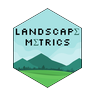
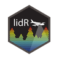
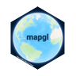
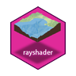
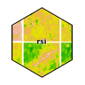
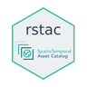
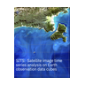
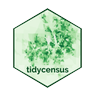
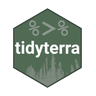
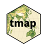

# R packages

Spatial classes, raster and vector analysis, statistics and mapping packages for R.

-   { .logo .middle } __[elevatr](elevatr.md)__

    ---

    Retrieves point elevations and raster DEMs from AWS Terrain Tiles and other sources into R.

    [:lucide-arrow-right: Details](elevatr.md)

-   :lucide-sigma:{ .lg .middle } __[exactextractr](exactextractr.md)__

    ---

    Fast, accurate zonal statistics in R that weight raster cells by the fraction covered by each polygon.

    [:lucide-arrow-right: Details](exactextractr.md)

-   { .logo .middle } __[gdalcubes](gdalcubes.md)__

    ---

    Builds on-demand multidimensional data cubes from satellite image collections in R, with a C++ engine and Python bindings.

    [:lucide-arrow-right: Details](gdalcubes.md)

-   :lucide-sigma:{ .lg .middle } __[gdalraster](gdalraster.md)__

    ---

    R bindings to the GDAL API for low-level raster and vector access, with a GDALRaster class and utilities.

    [:lucide-arrow-right: Details](gdalraster.md)

-   :lucide-sigma:{ .lg .middle } __[ggspatial](ggspatial.md)__

    ---

    Adds spatial data layers, scale bars, north arrows and basemap tiles to ggplot2 maps.

    [:lucide-arrow-right: Details](ggspatial.md)

-   :lucide-sigma:{ .lg .middle } __[gstat](gstat.md)__

    ---

    Geostatistical modeling, variogram fitting, kriging and simulation in R.

    [:lucide-arrow-right: Details](gstat.md)

-   { .logo .middle } __[landscapemetrics](landscapemetrics.md)__

    ---

    Calculates landscape metrics for categorical rasters in a tidy workflow, reproducing FRAGSTATS metrics.

    [:lucide-arrow-right: Details](landscapemetrics.md)

-   :lucide-sigma:{ .lg .middle } __[leaflet](leaflet-r.md)__

    ---

    R interface to the Leaflet JavaScript library for interactive web maps in R Markdown and Shiny.

    [:lucide-arrow-right: Details](leaflet-r.md)

-   { .logo .middle } __[lidR](lidr.md)__

    ---

    Reads and processes airborne LiDAR data in R, with ground classification, canopy height models, tree segmentation and area-based metrics.

    [:lucide-arrow-right: Details](lidr.md)

-   :lucide-sigma:{ .lg .middle } __[lwgeom](lwgeom.md)__

    ---

    R bindings to liblwgeom from PostGIS that add geodesic and other functions to sf.

    [:lucide-arrow-right: Details](lwgeom.md)

-   { .logo .middle } __[mapgl](mapgl.md)__

    ---

    R interface to Mapbox GL JS and MapLibre GL JS for interactive vector-tile maps in R and Shiny.

    [:lucide-arrow-right: Details](mapgl.md)

-   :lucide-sigma:{ .lg .middle } __[mapview](mapview.md)__

    ---

    Quick interactive viewing of spatial objects in R using Leaflet, with layer controls and synchronized views.

    [:lucide-arrow-right: Details](mapview.md)

-   :lucide-sigma:{ .lg .middle } __[osmdata](osmdata.md)__

    ---

    Downloads OpenStreetMap data through the Overpass API into sf or sp objects.

    [:lucide-arrow-right: Details](osmdata.md)

-   :lucide-sigma:{ .lg .middle } __[qgisprocess](qgisprocess.md)__

    ---

    Runs QGIS Processing algorithms, including GRASS and SAGA providers, from R.

    [:lucide-arrow-right: Details](qgisprocess.md)

-   :lucide-sigma:{ .lg .middle } __[raster](raster.md)__

    ---

    Original R package for raster data, still maintained but superseded by terra for most new work.

    [:lucide-arrow-right: Details](raster.md)

-   { .logo .middle } __[rayshader](rayshader.md)__

    ---

    Creates 2D and 3D hillshaded maps and visualizations from elevation matrices and ggplot2 objects in R.

    [:lucide-arrow-right: Details](rayshader.md)

-   { .logo .middle } __[rgee](rgee.md)__

    ---

    R client for Google Earth Engine that wraps the Python API through reticulate.

    [:lucide-arrow-right: Details](rgee.md)

-   :lucide-sigma:{ .lg .middle } __[rgrass](rgrass.md)__

    ---

    Interface between R and GRASS GIS, to run GRASS modules and exchange data with sf and terra.

    [:lucide-arrow-right: Details](rgrass.md)

-   :lucide-sigma:{ .lg .middle } __[rnaturalearth](rnaturalearth.md)__

    ---

    Loads Natural Earth boundaries, coastlines and populated places into R as sf or terra objects.

    [:lucide-arrow-right: Details](rnaturalearth.md)

-   :lucide-sigma:{ .lg .middle } __[Rsagacmd](rsagacmd.md)__

    ---

    R wrapper that exposes SAGA GIS tools as R functions and returns results as terra or sf objects.

    [:lucide-arrow-right: Details](rsagacmd.md)

-   { .logo .middle } __[rsi](rsi.md)__

    ---

    Retrieves satellite imagery from STAC catalogs and calculates spectral indices in R.

    [:lucide-arrow-right: Details](rsi.md)

-   { .logo .middle } __[rstac](rstac.md)__

    ---

    R client for STAC APIs to search and access Earth observation assets.

    [:lucide-arrow-right: Details](rstac.md)

-   :lucide-sigma:{ .lg .middle } __[s2](s2-r.md)__

    ---

    R bindings to Google's S2 library, used by sf for spherical geometry on longitude and latitude coordinates.

    [:lucide-arrow-right: Details](s2-r.md)

-   { .logo .middle } __[sf](sf.md)__

    ---

    Simple Features for R. Stores vector data as data frames with geometry columns and wraps GDAL, GEOS, PROJ and s2 for spatial operations.

    [:lucide-arrow-right: Details](sf.md)

-   { .logo .middle } __[sits](sits.md)__

    ---

    Satellite image time series analysis in R, from data cubes to machine learning classification and land use maps.

    [:lucide-arrow-right: Details](sits.md)

-   :lucide-sigma:{ .lg .middle } __[sp](sp.md)__

    ---

    Classes and methods for spatial data in R that defined the ecosystem before sf. Kept for backward compatibility.

    [:lucide-arrow-right: Details](sp.md)

-   :lucide-sigma:{ .lg .middle } __[spatialreg](spatialreg.md)__

    ---

    Spatial lag, spatial error and related regression models for areal data in R, split out of spdep.

    [:lucide-arrow-right: Details](spatialreg.md)

-   :lucide-sigma:{ .lg .middle } __[spatstat](spatstat.md)__

    ---

    Analysis and modeling of spatial point patterns in R, including intensity, point process models and simulation.

    [:lucide-arrow-right: Details](spatstat.md)

-   :lucide-sigma:{ .lg .middle } __[spdep](spdep.md)__

    ---

    Spatial weights, neighborhood graphs, Moran's I, Geary's C, local indicators and spatial regression diagnostics for R.

    [:lucide-arrow-right: Details](spdep.md)

-   :lucide-sigma:{ .lg .middle } __[stars](stars.md)__

    ---

    Spatiotemporal arrays for R that handle raster and vector data cubes, with lazy reading of large rasters and integration with sf.

    [:lucide-arrow-right: Details](stars.md)

-   { .logo .middle } __[terra](terra.md)__

    ---

    R package for raster and vector data, the successor to raster, with fast C++ processing, large file support and a SpatRaster and SpatVector class system.

    [:lucide-arrow-right: Details](terra.md)

-   { .logo .middle } __[tidycensus](tidycensus.md)__

    ---

    Pulls US Census and American Community Survey data into tidy data frames, optionally with geometry.

    [:lucide-arrow-right: Details](tidycensus.md)

-   { .logo .middle } __[tidyterra](tidyterra.md)__

    ---

    Tidyverse methods and ggplot2 geoms for terra objects such as SpatRaster and SpatVector.

    [:lucide-arrow-right: Details](tidyterra.md)

-   :lucide-sigma:{ .lg .middle } __[tigris](tigris.md)__

    ---

    Downloads and loads US Census TIGER/Line boundaries as sf objects.

    [:lucide-arrow-right: Details](tigris.md)

-   { .logo .middle } __[tmap](tmap.md)__

    ---

    Thematic maps in R with a layered grammar similar to ggplot2, with static and interactive modes.

    [:lucide-arrow-right: Details](tmap.md)

-   :lucide-sigma:{ .lg .middle } __[whitebox](whiteboxr.md)__

    ---

    R frontend for WhiteboxTools, with hundreds of terrain, hydrology and LiDAR tools.

    [:lucide-arrow-right: Details](whiteboxr.md)

