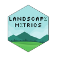

# { .title-logo } landscapemetrics

Calculates landscape metrics for categorical rasters in a tidy workflow, reproducing FRAGSTATS metrics.

[:lucide-download: Get the software](https://cran.r-project.org/package=landscapemetrics){ .md-button .md-button--primary }
[:lucide-book-open: Documentation](https://r-spatialecology.github.io/landscapemetrics/){ .md-button }
[:lucide-code: Source code](https://github.com/r-spatialecology/landscapemetrics){ .md-button }

## At a glance

| Field | Value |
| --- | --- |
| :lucide-building-2:{ title="Who develops or maintains the software" } Developer | Maximilian Hesselbarth |
| :lucide-monitor-smartphone:{ title="Operating systems and delivery" } Platforms | Windows, macOS, Linux |
| :lucide-code-xml:{ title="Implementation or scripting languages" } Languages | R |
| :lucide-mouse-pointer-click:{ title="How you use it" } Interface | Library |
| :lucide-scale:{ title="Terms of use. Check the provider before redistributing" } License | GPL-3.0 |
| :lucide-circle-dollar-sign:{ title="What it costs to use" } Cost | Open source |
| :lucide-activity:{ title="Development state when the entry was written" } Status | Active |

## Related software

- [FRAGSTATS](../spatial-analysis/fragstats.md)
- [terra](../r/terra.md)

[:lucide-arrow-left: Back to R packages](index.md){ .md-button }
