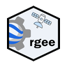

# { .title-logo } rgee

R client for Google Earth Engine that wraps the Python API through reticulate.

[:lucide-download: Get the software](https://cran.r-project.org/package=rgee){ .md-button .md-button--primary }
[:lucide-book-open: Documentation](https://r-spatial.github.io/rgee/){ .md-button }
[:lucide-code: Source code](https://github.com/r-spatial/rgee){ .md-button }

## At a glance

| Field | Value |
| --- | --- |
| :lucide-building-2:{ title="Who develops or maintains the software" } Developer | Cesar Aybar |
| :lucide-monitor-smartphone:{ title="Operating systems and delivery" } Platforms | Windows, macOS, Linux |
| :lucide-code-xml:{ title="Implementation or scripting languages" } Languages | R |
| :lucide-mouse-pointer-click:{ title="How you use it" } Interface | Library, API |
| :lucide-scale:{ title="Terms of use. Check the provider before redistributing" } License | Apache-2.0 |
| :lucide-circle-dollar-sign:{ title="What it costs to use" } Cost | Free to use |
| :lucide-activity:{ title="Development state when the entry was written" } Status | Maintenance mode |

## Related software

- [Earth Engine Python API](../python/earthengine-api.md)

[:lucide-arrow-left: Back to R packages](index.md){ .md-button }
