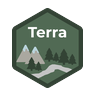

# { .title-logo } terra

R package for raster and vector data, the successor to raster, with fast C++ processing, large file support and a SpatRaster and SpatVector class system.

[:lucide-download: Get the software](https://cran.r-project.org/package=terra){ .md-button .md-button--primary }
[:lucide-book-open: Documentation](https://rspatial.github.io/terra/){ .md-button }
[:lucide-code: Source code](https://github.com/rspatial/terra){ .md-button }

## At a glance

| Field | Value |
| --- | --- |
| :lucide-building-2:{ title="Who develops or maintains the software" } Developer | Robert Hijmans |
| :lucide-monitor-smartphone:{ title="Operating systems and delivery" } Platforms | Windows, macOS, Linux |
| :lucide-code-xml:{ title="Implementation or scripting languages" } Languages | R, C++ |
| :lucide-mouse-pointer-click:{ title="How you use it" } Interface | Library |
| :lucide-scale:{ title="Terms of use. Check the provider before redistributing" } License | GPL-3.0-or-later |
| :lucide-circle-dollar-sign:{ title="What it costs to use" } Cost | Open source |
| :lucide-activity:{ title="Development state when the entry was written" } Status | Active |

## Quick start

=== "R"

    ```r
    library(terra)
    r <- rast("dem.tif")
    slope <- terrain(r, "slope", unit = "degrees")
    v <- vect("counties.gpkg")
    extract(r, v, fun = mean)
    ```


## Related software

- [raster](../r/raster.md)
- [sf](../r/sf.md)
- [stars](../r/stars.md)
- [rasterio](../python/rasterio.md)

<script type="application/ld+json">{"@context": "https://schema.org/", "@type": "SoftwareApplication", "name": "terra", "description": "R package for raster and vector data, the successor to raster, with fast C++ processing, large file support and a SpatRaster and SpatVector class system.", "url": "https://noahweidig.github.io/awesome-geospatial-software/software/r/terra/", "applicationCategory": "R packages", "operatingSystem": "Windows, macOS, Linux", "programmingLanguage": ["R", "C++"], "author": {"@type": "Organization", "name": "Robert Hijmans"}, "keywords": ["Windows", "macOS", "Linux", "Library", "R", "C++", "Open source", "Active", "GPL", "Raster", "Vector", "Geoprocessing"], "license": "GPL-3.0-or-later", "sameAs": "https://rspatial.github.io/terra/", "downloadUrl": "https://cran.r-project.org/package=terra", "image": "https://noahweidig.github.io/awesome-geospatial-software/assets/logos/terra.png", "codeRepository": "https://github.com/rspatial/terra"}</script>

[:lucide-arrow-left: Back to R packages](index.md){ .md-button }
