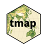

# { .title-logo } tmap

Thematic maps in R with a layered grammar similar to ggplot2, with static and interactive modes.

[:lucide-download: Get the software](https://cran.r-project.org/package=tmap){ .md-button .md-button--primary }
[:lucide-book-open: Documentation](https://r-tmap.github.io/tmap/){ .md-button }
[:lucide-code: Source code](https://github.com/r-tmap/tmap){ .md-button }

## At a glance

| Field | Value |
| --- | --- |
| :lucide-building-2:{ title="Who develops or maintains the software" } Developer | Martijn Tennekes |
| :lucide-monitor-smartphone:{ title="Operating systems and delivery" } Platforms | Windows, macOS, Linux |
| :lucide-code-xml:{ title="Implementation or scripting languages" } Languages | R |
| :lucide-mouse-pointer-click:{ title="How you use it" } Interface | Library |
| :lucide-scale:{ title="Terms of use. Check the provider before redistributing" } License | GPL-3.0 |
| :lucide-circle-dollar-sign:{ title="What it costs to use" } Cost | Open source |
| :lucide-activity:{ title="Development state when the entry was written" } Status | Active |

## Quick start

=== "R"

    ```r
    library(tmap)
    tm_shape(World) + tm_polygons("HPI")
    ```


## Related software

- [mapview](../r/mapview.md)
- [ggspatial](../r/ggspatial.md)

<script type="application/ld+json">{"@context": "https://schema.org/", "@type": "SoftwareApplication", "name": "tmap", "description": "Thematic maps in R with a layered grammar similar to ggplot2, with static and interactive modes.", "url": "https://noahweidig.github.io/awesome-geospatial-software/software/r/tmap/", "applicationCategory": "R packages", "operatingSystem": "Windows, macOS, Linux", "programmingLanguage": ["R"], "author": {"@type": "Organization", "name": "Martijn Tennekes"}, "keywords": ["Windows", "macOS", "Linux", "Library", "R", "Open source", "Active", "GPL", "Cartography", "Visualization"], "license": "GPL-3.0", "sameAs": "https://r-tmap.github.io/tmap/", "downloadUrl": "https://cran.r-project.org/package=tmap", "image": "https://noahweidig.github.io/awesome-geospatial-software/assets/logos/tmap.png", "codeRepository": "https://github.com/r-tmap/tmap"}</script>

[:lucide-arrow-left: Back to R packages](index.md){ .md-button }
