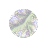
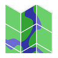
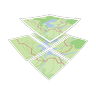
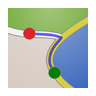
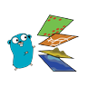

# Map servers, tiles & APIs

Servers and tools that publish OGC services, vector tiles, raster tiles and feature APIs.

-   { .logo .middle } __[actinia](actinia.md)__

    ---

    REST API that runs GRASS GIS and other geoprocessing in the cloud for large raster, vector and time-series jobs.

    [:lucide-arrow-right: Details](actinia.md)

-   { .logo .middle } __[ArcGIS Enterprise](arcgis-enterprise.md)__

    ---

    Esri's self-hosted GIS platform with ArcGIS Server, portal, data store and web apps for sharing maps and services inside an organization.

    [:lucide-arrow-right: Details](arcgis-enterprise.md)

-   { .logo .middle } __[GeoServer](geoserver.md)__

    ---

    Java server that publishes spatial data through OGC services such as WMS, WFS, WCS and WMTS, with a web admin interface and styling with SLD and CSS.

    [:lucide-arrow-right: Details](geoserver.md)

-   { .logo .middle } __[GeoWebCache](geowebcache.md)__

    ---

    Java tile cache that stores and serves WMS-backed map tiles through WMTS, TMS and other protocols. It is built into GeoServer.

    [:lucide-arrow-right: Details](geowebcache.md)

-   { .logo .middle } __[Mapnik](mapnik.md)__

    ---

    C++ toolkit for rendering vector and raster data into map tiles and images, used by OpenStreetMap's standard tile layer.

    [:lucide-arrow-right: Details](mapnik.md)

-   { .logo .middle } __[MapProxy](mapproxy.md)__

    ---

    Python proxy and tile cache that accelerates WMS and tile services, reprojects sources and merges layers.

    [:lucide-arrow-right: Details](mapproxy.md)

-   { .logo .middle } __[MapServer](mapserver.md)__

    ---

    C-based server and CGI engine for publishing maps and data through OGC services, configured with Mapfiles.

    [:lucide-arrow-right: Details](mapserver.md)

-   { .logo .middle } __[Martin](martin.md)__

    ---

    Rust tile server that serves vector tiles from PostGIS, MBTiles and PMTiles, with sprite and font endpoints.

    [:lucide-arrow-right: Details](martin.md)

-   { .logo .middle } __[OpenMapTiles](openmaptiles.md)__

    ---

    Vector tile schema and toolchain that turns OpenStreetMap data into a documented set of layers for basemaps.

    [:lucide-arrow-right: Details](openmaptiles.md)

-   { .logo .middle } __[pg_featureserv](pg-featureserv.md)__

    ---

    Go server that publishes PostGIS data as an OGC API Features service with JSON and GeoJSON output.

    [:lucide-arrow-right: Details](pg-featureserv.md)

-   { .logo .middle } __[pg_tileserv](pg-tileserv.md)__

    ---

    Go server that publishes vector tiles from PostGIS tables, views and functions.

    [:lucide-arrow-right: Details](pg-tileserv.md)

-   { .logo .middle } __[Planetiler](planetiler.md)__

    ---

    Java tool that generates vector tiles for the whole planet from OpenStreetMap and other sources in hours on a single machine.

    [:lucide-arrow-right: Details](planetiler.md)

-   { .logo .middle } __[PMTiles](pmtiles.md)__

    ---

    Single-file archive format and tooling for tiles served with HTTP range requests from static storage, from Protomaps.

    [:lucide-arrow-right: Details](pmtiles.md)

-   { .logo .middle } __[PyWPS](pywps.md)__

    ---

    Python implementation of the OGC Web Processing Service standard.

    [:lucide-arrow-right: Details](pywps.md)

-   { .logo .middle } __[QGIS Server](qgis-server.md)__

    ---

    OGC web services backend that publishes QGIS projects as WMS, WFS, WCS and OGC API services using the same styling as the desktop.

    [:lucide-arrow-right: Details](qgis-server.md)

-   :lucide-server:{ .lg .middle } __[STAC Browser](stac-browser.md)__

    ---

    Web interface for browsing and searching STAC catalogs and collections.

    [:lucide-arrow-right: Details](stac-browser.md)

-   :lucide-server:{ .lg .middle } __[stac-fastapi](stac-fastapi.md)__

    ---

    Python implementation of the STAC API specification on FastAPI, with PostgreSQL and other backends.

    [:lucide-arrow-right: Details](stac-fastapi.md)

-   { .logo .middle } __[Tegola](tegola.md)__

    ---

    Go vector tile server that reads PostGIS and GeoPackage and caches tiles to disk or cloud storage.

    [:lucide-arrow-right: Details](tegola.md)

-   :lucide-server:{ .lg .middle } __[Terracotta](terracotta.md)__

    ---

    Python tile server for serving raster files as XYZ tiles from a metadata database, designed to run serverless.

    [:lucide-arrow-right: Details](terracotta.md)

-   { .logo .middle } __[TileServer GL](tileserver-gl.md)__

    ---

    Node.js server for vector tiles and raster rendering from MBTiles and PMTiles using MapLibre GL styles.

    [:lucide-arrow-right: Details](tileserver-gl.md)

-   :lucide-server:{ .lg .middle } __[tippecanoe](tippecanoe.md)__

    ---

    Builds vector tilesets from large GeoJSON, FlatGeobuf and CSV collections, choosing which features to drop or simplify at each zoom level.

    [:lucide-arrow-right: Details](tippecanoe.md)

-   { .logo .middle } __[ZOO-Project](zoo-project.md)__

    ---

    Open source implementation of OGC Web Processing Service and OGC API Processes for publishing geoprocessing as web services.

    [:lucide-arrow-right: Details](zoo-project.md)

