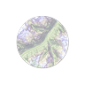

# { .title-logo } Mapnik

C++ toolkit for rendering vector and raster data into map tiles and images, used by OpenStreetMap's standard tile layer.

[:lucide-download: Get the software](https://mapnik.org/){ .md-button .md-button--primary }
[:lucide-book-open: Documentation](https://mapnik.org/docs/){ .md-button }
[:lucide-code: Source code](https://github.com/mapnik/mapnik){ .md-button }

## At a glance

| Field | Value |
| --- | --- |
| :lucide-building-2:{ title="Who develops or maintains the software" } Developer | Mapnik contributors |
| :lucide-monitor-smartphone:{ title="Operating systems and delivery" } Platforms | Windows, macOS, Linux |
| :lucide-code-xml:{ title="Implementation or scripting languages" } Languages | C++, Python |
| :lucide-mouse-pointer-click:{ title="How you use it" } Interface | Library |
| :lucide-scale:{ title="Terms of use. Check the provider before redistributing" } License | LGPL-2.1 |
| :lucide-circle-dollar-sign:{ title="What it costs to use" } Cost | Open source |
| :lucide-activity:{ title="Development state when the entry was written" } Status | Active |

## Related software

- [OpenStreetMap Carto](../osm/openstreetmap-carto.md)
- [TileServer GL](../servers-tiles/tileserver-gl.md)

[:lucide-arrow-left: Back to Map servers, tiles & APIs](index.md){ .md-button }
