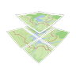

# { .title-logo } OpenMapTiles

Vector tile schema and toolchain that turns OpenStreetMap data into a documented set of layers for basemaps.

[:lucide-download: Get the software](https://openmaptiles.org/){ .md-button .md-button--primary }
[:lucide-book-open: Documentation](https://openmaptiles.org/docs/){ .md-button }
[:lucide-code: Source code](https://github.com/openmaptiles/openmaptiles){ .md-button }

## At a glance

| Field | Value |
| --- | --- |
| :lucide-building-2:{ title="Who develops or maintains the software" } Developer | MapTiler |
| :lucide-monitor-smartphone:{ title="Operating systems and delivery" } Platforms | Linux, macOS, Windows |
| :lucide-code-xml:{ title="Implementation or scripting languages" } Languages | SQL, Python |
| :lucide-mouse-pointer-click:{ title="How you use it" } Interface | Command line |
| :lucide-scale:{ title="Terms of use. Check the provider before redistributing" } License | BSD-3-Clause (code), CC-BY 4.0 (design) |
| :lucide-circle-dollar-sign:{ title="What it costs to use" } Cost | Open source |
| :lucide-activity:{ title="Development state when the entry was written" } Status | Active |

## Related software

- [Planetiler](../servers-tiles/planetiler.md)
- [TileServer GL](../servers-tiles/tileserver-gl.md)

[:lucide-arrow-left: Back to Map servers, tiles & APIs](index.md){ .md-button }
