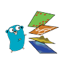

# { .title-logo } Tegola

Go vector tile server that reads PostGIS and GeoPackage and caches tiles to disk or cloud storage.

[:lucide-download: Get the software](https://tegola.io/){ .md-button .md-button--primary }
[:lucide-book-open: Documentation](https://tegola.io/documentation/){ .md-button }
[:lucide-code: Source code](https://github.com/go-spatial/tegola){ .md-button }

## At a glance

| Field | Value |
| --- | --- |
| :lucide-building-2:{ title="Who develops or maintains the software" } Developer | Tegola contributors |
| :lucide-monitor-smartphone:{ title="Operating systems and delivery" } Platforms | Windows, macOS, Linux, Server |
| :lucide-code-xml:{ title="Implementation or scripting languages" } Languages | Go |
| :lucide-mouse-pointer-click:{ title="How you use it" } Interface | Service, Command line |
| :lucide-scale:{ title="Terms of use. Check the provider before redistributing" } License | MIT |
| :lucide-circle-dollar-sign:{ title="What it costs to use" } Cost | Open source |
| :lucide-activity:{ title="Development state when the entry was written" } Status | Active |

## Related software

- [Martin](../servers-tiles/martin.md)
- [pg_tileserv](../servers-tiles/pg-tileserv.md)

[:lucide-arrow-left: Back to Map servers, tiles & APIs](index.md){ .md-button }
