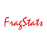

# { .title-logo } FRAGSTATS

Spatial pattern analysis program that computes landscape metrics for categorical maps.

[:lucide-download: Get the software](https://fragstats.org/){ .md-button .md-button--primary }
[:lucide-book-open: Documentation](https://fragstats.org/index.php/documentation){ .md-button }

## At a glance

| Field | Value |
| --- | --- |
| :lucide-building-2:{ title="Who develops or maintains the software" } Developer | Kevin McGarigal, University of Massachusetts Amherst |
| :lucide-monitor-smartphone:{ title="Operating systems and delivery" } Platforms | Windows |
| :lucide-code-xml:{ title="Implementation or scripting languages" } Languages | Vendor-specific |
| :lucide-mouse-pointer-click:{ title="How you use it" } Interface | GUI, Command line |
| :lucide-scale:{ title="Terms of use. Check the provider before redistributing" } License | Free to use (see site) |
| :lucide-circle-dollar-sign:{ title="What it costs to use" } Cost | Free to use |
| :lucide-activity:{ title="Development state when the entry was written" } Status | Active |

## Related software

- [landscapemetrics](../r/landscapemetrics.md)

[:lucide-arrow-left: Back to Spatial statistics & ecology](index.md){ .md-button }
