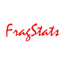

# Spatial statistics & ecology

Spatial autocorrelation, regression, geostatistics, habitat and landscape models.

-   { .logo .middle } __[Circuitscape](circuitscape.md)__

    ---

    Models ecological connectivity using circuit theory, with a Julia implementation, to map gene flow and movement corridors.

    [:lucide-arrow-right: Details](circuitscape.md)

-   { .logo .middle } __[Dinamica EGO](dinamica-ego.md)__

    ---

    Environmental modeling platform for land use and land cover change, with a graphical model builder and cellular automata.

    [:lucide-arrow-right: Details](dinamica-ego.md)

-   :lucide-chart-scatter:{ .lg .middle } __[dismo](dismo.md)__

    ---

    R package for species distribution modeling, including a Maxent interface, bioclimatic models and species data access.

    [:lucide-arrow-right: Details](dismo.md)

-   { .logo .middle } __[FRAGSTATS](fragstats.md)__

    ---

    Spatial pattern analysis program that computes landscape metrics for categorical maps.

    [:lucide-arrow-right: Details](fragstats.md)

-   { .logo .middle } __[GeoDa](geoda.md)__

    ---

    Free desktop software for exploratory spatial data analysis, with spatial autocorrelation, cluster maps and spatial regression.

    [:lucide-arrow-right: Details](geoda.md)

-   { .logo .middle } __[GSTools](gstools.md)__

    ---

    Python toolbox for geostatistics with covariance models, random field generation, variogram estimation and kriging.

    [:lucide-arrow-right: Details](gstools.md)

-   :lucide-chart-scatter:{ .lg .middle } __[GWmodel](gwmodel.md)__

    ---

    R package for geographically weighted models, including regression, summary statistics, principal components and discriminant analysis.

    [:lucide-arrow-right: Details](gwmodel.md)

-   { .logo .middle } __[InVEST](invest.md)__

    ---

    Natural Capital Project suite of models for mapping and valuing ecosystem services such as carbon storage, water yield and habitat quality.

    [:lucide-arrow-right: Details](invest.md)

-   :lucide-chart-scatter:{ .lg .middle } __[Marxan](marxan.md)__

    ---

    Decision support software for systematic conservation planning that selects efficient sets of areas to meet biodiversity targets.

    [:lucide-arrow-right: Details](marxan.md)

-   :lucide-chart-scatter:{ .lg .middle } __[Maxent](maxent.md)__

    ---

    Java program that models species geographic distributions from presence-only records and environmental layers using maximum entropy.

    [:lucide-arrow-right: Details](maxent.md)

-   { .logo .middle } __[MGWR](mgwr.md)__

    ---

    Multiscale geographically weighted regression in Python, with a desktop GUI and PySAL integration.

    [:lucide-arrow-right: Details](mgwr.md)

-   { .logo .middle } __[prioritizr](prioritizr.md)__

    ---

    R package for systematic conservation prioritization using integer linear programming and flexible problem formulation.

    [:lucide-arrow-right: Details](prioritizr.md)

-   { .logo .middle } __[PyKrige](pykrige.md)__

    ---

    Kriging toolkit for Python with ordinary, universal and regression kriging and variogram models.

    [:lucide-arrow-right: Details](pykrige.md)

-   :lucide-chart-scatter:{ .lg .middle } __[SaTScan](satscan.md)__

    ---

    Free software for spatial, temporal and space-time scan statistics used to detect disease clusters and other hotspots.

    [:lucide-arrow-right: Details](satscan.md)

-   { .logo .middle } __[Zonation](zonation.md)__

    ---

    Spatial conservation prioritization software that ranks landscape cells by their value for biodiversity features.

    [:lucide-arrow-right: Details](zonation.md)

