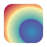

# { .title-logo } Zonation

Spatial conservation prioritization software that ranks landscape cells by their value for biodiversity features.

[:lucide-download: Get the software](https://github.com/zonationteam/Zonation5){ .md-button .md-button--primary }
[:lucide-book-open: Documentation](https://zonationteam.github.io/Zonation5/){ .md-button }
[:lucide-code: Source code](https://github.com/zonationteam/Zonation5){ .md-button }

## At a glance

| Field | Value |
| --- | --- |
| :lucide-building-2:{ title="Who develops or maintains the software" } Developer | University of Helsinki |
| :lucide-monitor-smartphone:{ title="Operating systems and delivery" } Platforms | Windows, Linux |
| :lucide-code-xml:{ title="Implementation or scripting languages" } Languages | C++ |
| :lucide-mouse-pointer-click:{ title="How you use it" } Interface | Command line |
| :lucide-scale:{ title="Terms of use. Check the provider before redistributing" } License | GPL-3.0 |
| :lucide-circle-dollar-sign:{ title="What it costs to use" } Cost | Open source |
| :lucide-activity:{ title="Development state when the entry was written" } Status | Maintenance mode |

## Related software

- [Marxan](../spatial-analysis/marxan.md)
- [prioritizr](../spatial-analysis/prioritizr.md)

[:lucide-arrow-left: Back to Spatial statistics & ecology](index.md){ .md-button }
