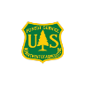

# { .title-logo } FlamMap

Fire analysis desktop application that simulates fire behavior, growth and burn probability on landscape files. It includes the FARSITE engine.

[:lucide-download: Get the software](https://research.fs.usda.gov/firelab/products/dataandtools/flammap){ .md-button .md-button--primary }
[:lucide-book-open: Documentation](https://research.fs.usda.gov/firelab/products/dataandtools/flammap){ .md-button }

## At a glance

| Field | Value |
| --- | --- |
| :lucide-building-2:{ title="Who develops or maintains the software" } Developer | USDA Forest Service Missoula Fire Sciences Laboratory |
| :lucide-monitor-smartphone:{ title="Operating systems and delivery" } Platforms | Windows |
| :lucide-code-xml:{ title="Implementation or scripting languages" } Languages | C++ |
| :lucide-mouse-pointer-click:{ title="How you use it" } Interface | GUI |
| :lucide-scale:{ title="Terms of use. Check the provider before redistributing" } License | Public domain |
| :lucide-circle-dollar-sign:{ title="What it costs to use" } Cost | Free to use |
| :lucide-activity:{ title="Development state when the entry was written" } Status | Active |

!!! warning "Caveat"

    Windows only. Needs a landscape file, for example from LANDFIRE. See the Awesome Fire Datasets catalog for input data.

## Related software

- [WindNinja](../terrain-hydrology/windninja.md)

[:lucide-arrow-left: Back to Terrain, hydrology & hazards](index.md){ .md-button }
