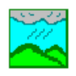

# Terrain, hydrology & hazards

DEM analysis, watershed delineation, flood modeling and wind and fire behavior tools.

-   { .logo .middle } __[FlamMap](flammap.md)__

    ---

    Fire analysis desktop application that simulates fire behavior, growth and burn probability on landscape files. It includes the FARSITE engine.

    [:lucide-arrow-right: Details](flammap.md)

-   { .logo .middle } __[gdaldem](gdal-terrain.md)__

    ---

    GDAL utility that computes hillshade, slope, aspect, roughness and color relief from a DEM.

    [:lucide-arrow-right: Details](gdal-terrain.md)

-   { .logo .middle } __[HEC-HMS](hec-hms.md)__

    ---

    US Army Corps of Engineers hydrologic modeling system for simulating rainfall-runoff and watershed processes, with GIS preprocessing.

    [:lucide-arrow-right: Details](hec-hms.md)

-   { .logo .middle } __[HEC-RAS](hec-ras.md)__

    ---

    US Army Corps of Engineers software for one- and two-dimensional river hydraulics, with RAS Mapper for flood inundation mapping.

    [:lucide-arrow-right: Details](hec-ras.md)

-   :lucide-mountain:{ .lg .middle } __[LISFLOOD-FP](lisflood-fp.md)__

    ---

    Raster-based two-dimensional flood inundation model from the University of Bristol for river and coastal flooding.

    [:lucide-arrow-right: Details](lisflood-fp.md)

-   { .logo .middle } __[PCRaster](pcraster.md)__

    ---

    Environmental modeling framework with a Python interface for building spatio-temporal dynamic models on rasters.

    [:lucide-arrow-right: Details](pcraster.md)

-   :lucide-mountain:{ .lg .middle } __[pysheds](pysheds.md)__

    ---

    Python library for watershed delineation, flow routing and stream extraction from digital elevation models.

    [:lucide-arrow-right: Details](pysheds.md)

-   :lucide-mountain:{ .lg .middle } __[RichDEM](richdem.md)__

    ---

    High-performance terrain and hydrology library for depression filling, flow accumulation and slope calculations on very large DEMs.

    [:lucide-arrow-right: Details](richdem.md)

-   { .logo .middle } __[SWAT+](swat-plus.md)__

    ---

    Watershed model for simulating water, sediment and nutrient yields under land management, with a QGIS interface called QSWAT+.

    [:lucide-arrow-right: Details](swat-plus.md)

-   :lucide-mountain:{ .lg .middle } __[TauDEM](taudem.md)__

    ---

    Terrain Analysis Using Digital Elevation Models, with parallel tools for flow direction, watershed delineation and stream networks.

    [:lucide-arrow-right: Details](taudem.md)

-   :lucide-mountain:{ .lg .middle } __[Verde](verde.md)__

    ---

    Python library for processing and gridding spatial data such as bathymetry and gravity, with scikit-learn-style gridders.

    [:lucide-arrow-right: Details](verde.md)

-   :lucide-mountain:{ .lg .middle } __[WhiteboxTools](whiteboxtools.md)__

    ---

    Command line geoprocessing library with hundreds of terrain, hydrology, LiDAR and remote sensing tools, written in Rust.

    [:lucide-arrow-right: Details](whiteboxtools.md)

-   { .logo .middle } __[WindNinja](windninja.md)__

    ---

    Computer program that computes spatially varying wind fields over complex terrain for fire behavior and other applications.

    [:lucide-arrow-right: Details](windninja.md)

