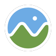
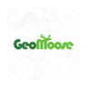
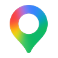
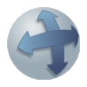
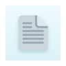
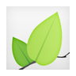
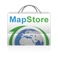
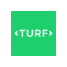

# Web mapping libraries & SDKs

JavaScript and native SDKs for interactive maps, globes and browser-side geoprocessing.

-   { .logo .middle } __[ArcGIS Maps SDK for JavaScript](arcgis-maps-sdk-js.md)__

    ---

    Esri's JavaScript SDK for 2D maps and 3D scenes, with web components and access to ArcGIS content and analysis services.

    [:lucide-arrow-right: Details](arcgis-maps-sdk-js.md)

-   { .logo .middle } __[CesiumJS](cesiumjs.md)__

    ---

    JavaScript library for 3D globes and maps, with terrain, imagery, time-dynamic data and 3D Tiles streaming.

    [:lucide-arrow-right: Details](cesiumjs.md)

-   { .logo .middle } __[D3](d3-geo.md)__

    ---

    D3's geographic module for projections, path generators and spherical math, used for custom SVG and canvas maps.

    [:lucide-arrow-right: Details](d3-geo.md)

-   :lucide-globe:{ .lg .middle } __[deck.gl](deckgl.md)__

    ---

    WebGL framework for visualizing large datasets as layers on maps, with scatterplot, hexagon, arc, trip and 3D tile layers.

    [:lucide-arrow-right: Details](deckgl.md)

-   { .logo .middle } __[GeoMoose](geomoose.md)__

    ---

    Web GIS framework for building mapping applications on OpenLayers and OGC services.

    [:lucide-arrow-right: Details](geomoose.md)

-   { .logo .middle } __[geotiff.js](geotiff-js.md)__

    ---

    JavaScript library for reading GeoTIFF and Cloud Optimized GeoTIFF files in the browser using HTTP range requests.

    [:lucide-arrow-right: Details](geotiff-js.md)

-   :lucide-globe:{ .lg .middle } __[globe.gl](globe-gl.md)__

    ---

    Three.js-based web component for data visualization on a 3D globe, with points, arcs, polygons and heatmaps.

    [:lucide-arrow-right: Details](globe-gl.md)

-   { .logo .middle } __[Google Maps Platform](google-maps-platform.md)__

    ---

    Google's JavaScript, Android and iOS map SDKs and web service APIs for places, geocoding, directions and elevation.

    [:lucide-arrow-right: Details](google-maps-platform.md)

-   { .logo .middle } __[HERE Platform and SDKs](here-platform.md)__

    ---

    HERE's map rendering SDKs and location APIs for geocoding, routing, traffic and fleet use cases.

    [:lucide-arrow-right: Details](here-platform.md)

-   { .logo .middle } __[iTowns](itowns.md)__

    ---

    Three.js-based framework for 3D geospatial visualization of terrain, 3D Tiles, point clouds and photogrammetry in the browser.

    [:lucide-arrow-right: Details](itowns.md)

-   :lucide-globe:{ .lg .middle } __[JSTS](jsts.md)__

    ---

    JavaScript port of the Java Topology Suite for geometry operations in the browser.

    [:lucide-arrow-right: Details](jsts.md)

-   { .logo .middle } __[kepler.gl](kepler-gl.md)__

    ---

    Browser-based tool for exploring large geospatial datasets, with map layers, filters, time playback and shareable maps.

    [:lucide-arrow-right: Details](kepler-gl.md)

-   { .logo .middle } __[Leaflet](leaflet.md)__

    ---

    Small, mobile-friendly JavaScript library for interactive maps, with a large plugin ecosystem.

    [:lucide-arrow-right: Details](leaflet.md)

-   { .logo .middle } __[Mapbender](mapbender.md)__

    ---

    Web mapping framework for building geoportals with configurable applications, OGC service support and a management backend.

    [:lucide-arrow-right: Details](mapbender.md)

-   { .logo .middle } __[Mapbox GL JS](mapbox-gl-js.md)__

    ---

    Mapbox's WebGL library for vector maps and 3D globes. Version 2 and later use a proprietary license that requires a Mapbox access token.

    [:lucide-arrow-right: Details](mapbox-gl-js.md)

-   { .logo .middle } __[MapLibre GL JS](maplibre-gl-js.md)__

    ---

    Open source WebGL library for vector tile maps, forked from Mapbox GL JS v1 before its license changed.

    [:lucide-arrow-right: Details](maplibre-gl-js.md)

-   { .logo .middle } __[MapLibre Native](maplibre-native.md)__

    ---

    Open source vector map rendering engine for Android, iOS and desktop, forked from Mapbox GL Native.

    [:lucide-arrow-right: Details](maplibre-native.md)

-   { .logo .middle } __[MapStore](mapstore.md)__

    ---

    Web mapping framework for creating, saving and sharing maps, dashboards and 3D stories, built on OpenLayers and Cesium.

    [:lucide-arrow-right: Details](mapstore.md)

-   { .logo .middle } __[maptalks.js](maptalks.md)__

    ---

    Lightweight JavaScript map library with 2D and 3D views, vector tiles and a plugin system.

    [:lucide-arrow-right: Details](maptalks.md)

-   { .logo .middle } __[MapTiler SDK JS](maptiler-sdk.md)__

    ---

    MapLibre-based JavaScript SDK from MapTiler that adds geocoding, elevation and hosted map styles.

    [:lucide-arrow-right: Details](maptiler-sdk.md)

-   { .logo .middle } __[OpenLayers](openlayers.md)__

    ---

    Feature-rich JavaScript mapping library that supports vector tiles, many projections, OGC services and WebGL rendering.

    [:lucide-arrow-right: Details](openlayers.md)

-   :lucide-globe:{ .lg .middle } __[proj4js](proj4js.md)__

    ---

    JavaScript library that transforms coordinates between projections in the browser and Node.js.

    [:lucide-arrow-right: Details](proj4js.md)

-   { .logo .middle } __[Terra Draw](terra-draw.md)__

    ---

    Library for drawing and editing geometries on web maps that works across Leaflet, OpenLayers, MapLibre, Mapbox and Google Maps.

    [:lucide-arrow-right: Details](terra-draw.md)

-   { .logo .middle } __[TomTom Maps SDK and APIs](tomtom-maps-sdk.md)__

    ---

    TomTom's maps, search, routing and traffic APIs with web and mobile SDKs.

    [:lucide-arrow-right: Details](tomtom-maps-sdk.md)

-   { .logo .middle } __[Turf.js](turf-js.md)__

    ---

    Modular JavaScript library for geospatial analysis in the browser or Node.js, with buffers, joins, interpolation and measurement.

    [:lucide-arrow-right: Details](turf-js.md)

