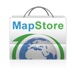

# { .title-logo } MapStore

Web mapping framework for creating, saving and sharing maps, dashboards and 3D stories, built on OpenLayers and Cesium.

[:lucide-download: Get the software](https://mapstore.geosolutionsgroup.com/){ .md-button .md-button--primary }
[:lucide-book-open: Documentation](https://mapstore.readthedocs.io/en/latest/){ .md-button }
[:lucide-code: Source code](https://github.com/geosolutions-it/MapStore2){ .md-button }

## At a glance

| Field | Value |
| --- | --- |
| :lucide-building-2:{ title="Who develops or maintains the software" } Developer | GeoSolutions |
| :lucide-monitor-smartphone:{ title="Operating systems and delivery" } Platforms | Server, Web browser |
| :lucide-code-xml:{ title="Implementation or scripting languages" } Languages | JavaScript, Java |
| :lucide-mouse-pointer-click:{ title="How you use it" } Interface | Web app |
| :lucide-scale:{ title="Terms of use. Check the provider before redistributing" } License | BSD-2-Clause |
| :lucide-circle-dollar-sign:{ title="What it costs to use" } Cost | Open source |
| :lucide-activity:{ title="Development state when the entry was written" } Status | Active |

## Related software

- [GeoServer](../servers-tiles/geoserver.md)
- [GeoNode](../etl-catalogs/geonode.md)

[:lucide-arrow-left: Back to Web mapping libraries & SDKs](index.md){ .md-button }
